# Results: validity-aware robustness of Ukrainian document retrieval to synonym substitution (CERT-UA)

Overnight runs 2026-10-12/13, human validity audit (887 verdicts in three passes) and fixed-denominator worst-case analysis. OpenAI spend $6.32. Generated by `experiments/s11_results.py`.

## Key findings

1. **RQ1: random meaning-preserving substitutions barely affect retrieval.** ΔR@5 on valid variants ≤ 2.5 pp for every retriever (BM25 2.5 ± 0.3, e5-base 1.8 ± 0.3, BGE-M3 0.7 ± 0.2, hybrid 0.1 ± 0.2 pp, section queries, 20 resamples).
2. **RQ2: human-verified targeted attacks are 2.8–4.6× more damaging than random substitutions (3.5–5.0× under auto validity), but affect a small share of queries.** Over all 586 queries (doc_max), a validity-aware greedy attack (only judge-accepted substitutions) pushes the source out of the attacked retriever's top 5 for bm25 32, e5_base 27, bge_m3 24, hybrid 17 queries (ΔR@5 2.9–5.5 pp). Every variant behind a successful attack was labelled by the human (batch 3), so the human-verified counts are exact: bm25 30, e5_base 26, bge_m3 18, hybrid 13 strictly valid (ΔR@5 2.2–5.1 pp, 2.8–4.6× random), bm25 27, e5_base 26, bge_m3 16, hybrid 12 if awkward wording is also rejected. The attack also moves R@1 (bm25 75.3 → 59.7, e5_base 65.4 → 55.1, bge_m3 69.8 → 65.0, hybrid 75.9 → 65.9 under auto validity). One random valid substitution per query costs 0.8–1.3 pp. The same attack WITHOUT validity in the search (select, then validate) finds only bm25 11, e5_base 7, bge_m3 4, hybrid 4 (human-verified census: bm25 11, e5_base 6, bge_m3 3, hybrid 4), i.e. no more than random: a validity-unaware attack spends its search on substitutions that are then rejected. A budget-matched control on single substitutions (same candidates, judge verdicts reused) shows the two searches are the two ends of one procedure: judging only the most damaging candidate reproduces S7 (8, 6, 3, 3 successful queries for bm25, e5_base, bge_m3, hybrid), two judge calls per chain give 13, 6, 6, 5, and judging all margin-lowering candidates (S15's step 1) gives 22, 24, 17, 12. The gain comes from spending judge calls inside the search, at about 4× S7's judge calls.
3. **RQ3: how validity is handled decides the robustness conclusion.** Of all 509 automatically accepted worst-case variants, a human judged 82% strictly and 99% leniently valid (census; 76% if awkward wording is also rejected). Strict validity is 81% for successful attacks, 74% for rank-worsening and 84% for harmless ones. On the stratified sample, GPT-4.1-mini agrees with the human at κ = 0.45 and MamayLM-12B at κ = 0.30. A blind second pass over the 165 texts behind successful attacks agreed with the first pass on 76% of the 45 previously labelled ones (7 downgraded, 4 upgraded). Building validity into the search instead of filtering afterwards multiplies successful attacks 2.9–6.0× (auto validity).
4. **Substitution source matters.** Strict human validity (random pool): curated technical terms 89%, LLM 86%, MLM 43%, dictionary 29%; only 14% of all admissible dictionary/MLM single substitutions pass the automatic judge.
5. **Mitigation.** Hybrid BM25+BGE-M3 is the most robust retriever under every attack; lemmatisation is essential for BM25 (section R@5 94.5 vs 83.2 without); fine-tuning improves clean retrieval, and synonym augmentation prevents e5-base from overfitting. Under worst-case attacks transferred from the frozen model (bge_m3 (frozen) 4.1 pp, e5_base (frozen) 4.6 pp auto; bge_m3 (frozen) 3.1 pp, e5_base (frozen) 4.4 pp verified; a transfer, not a re-attack, so not evidence of robustness to an attacker targeting the fine-tuned model): ft_bge_m3_ft_aug (5 seeds) ΔR@5 1.3 ± 0.3 pp (verified 0.7 ± 0.3); ft_bge_m3_ft_orig (5 seeds) ΔR@5 1.6 ± 0.5 pp (verified 0.8 ± 0.2); ft_e5_base_ft_aug (5 seeds) ΔR@5 1.4 ± 0.3 pp (verified 0.7 ± 0.1); ft_e5_base_ft_orig (5 seeds) ΔR@5 1.7 ± 0.7 pp (verified 0.7 ± 0.1).
6. **Inference-time query expansion gives no measurable gain** (appendix).

**Caveats.** Single annotator (self-consistency 94% on 31 hidden repeats; no inter-annotator κ); silver source-document labels (relevance spot-check: the rank-1 document answers the query for 0% of 24 attack-induced failures, at most partly for 12%; and for 8% of 12 clean hybrid failures, partly for 50%, mostly near-identical report series); greedy (not exhaustive) attacks; successful attacks are human-labelled in both searches, while the validity of S15 variants that did not succeed is estimated from the audit (it affects R@1/MRR at the estimated level, not success counts); fine-tuned models are evaluated on transferred attacks.

## Setup

- Corpus: 220 Ukrainian CERT-UA articles (1597 chunks), near-duplicate ['2624'] removed, titles stripped from indexed text (8 occurrences).
- Queries: 219 title queries (title → article) and 367 section questions (GPT-4.1-mini question from a narrative chunk → article / chunk). Silver labels = source.
- Perturbations: `dict` (synonym dictionary + morphology, ../textfooler_ukr), `mlm` (XLM-R-large fill-mask, ../bert_attack_uk), `tech` (40 curated technical term pairs), `llm` (GPT synonym substitution). Protected identifiers (CVE/UAC/CERT-UA IDs, hashes, IPs, domains, Latin names) are never changed.
- Automatic validity: GPT-4.1-mini judge says the information need is preserved AND SBERT (lang-uk mpnet) cosine ≥ 0.80. Human validity: blind audit by one annotator in passes — batch 1, a stratified sample of 254 substitutions (+15 repeats) over random/worst-case/dose pools; batch 2, the remaining 437 auto-accepted S7 worst-case variants (+10 repeats, census of 509); batch 3, a re-check of every variant text behind a successful S7 or S15 attack with an explicit grammar rule (its verdicts replace earlier ones). Strict = same need and not ungrammatical; lenient also accepts 'partly'; natural (sensitivity) also rejects awkward wording. Identical texts labelled more than once count as valid only if every label says so.
- Worst-case, two searches with identical candidates and constraints (≤ 2 words, ≤ 8 candidates per position, SBERT ≥ 0.85, protected entities): S15 (main) judges every admissible single first and searches over judge-valid ones (validate → select); S7 (comparison) searches all admissible candidates and judges the result (select → validate). A query without a valid attack keeps its original rank (fixed denominator of 586). Verified = accepted by the automatic rule and by the human.
- Retrievers (frozen): BM25 (pymorphy3 lemmas), multilingual-e5-base/large, BGE-M3 (dense, sparse, ColBERT, all), Ukrainian paraphrase mpnet, multilingual mpnet; hybrid = RRF(BM25, BGE-M3).
- Levels: `doc_max` (article ranked by its best chunk), `doc_full` (whole-article embedding), `chunk` (section queries → source chunk).
- Metrics: R@1/R@5/MRR, pessimistic ranks; 95% CIs by bootstrap over articles.

## 1. Benchmark

### Benchmark
| subset | n | with_identifier | articles |
|---|---|---|---|
| section | 367 | 56 | 207 |
| title | 219 | 146 | 219 |

Variants per perturbation type (judge_ok / valid in %):

| perturbation_type | n | queries | judge_ok | valid | mean_cos |
|---|---|---|---|---|---|
| dict | 1580 | 566 | 23.3 | 23.3 | 0.980 |
| llm | 1506 | 562 | 86.5 | 86.5 | 0.988 |
| mlm | 1738 | 584 | 15.3 | 15.3 | 0.959 |
| tech | 590 | 393 | 88.0 | 86.9 | 0.978 |

Manual audit sample: `audit_sample_variants.md`.

## 2. Clean retrieval (original queries)

### doc_max · title queries
| model | n | R@1 | R@5 | R@10 | MRR |
|---|---|---|---|---|---|
| bge_m3 | 219 | 55.7 | 80.8 | 87.2 | 0.670 |
| bm25 | 219 | 66.7 | 84.9 | 90.4 | 0.749 |
| bm25_surface | 219 | 59.8 | 79.5 | 87.2 | 0.694 |
| bm25_titled | 219 | 66.7 | 84.9 | 90.4 | 0.749 |
| e5_base | 219 | 48.9 | 72.1 | 79.5 | 0.596 |
| e5_large | 219 | 54.8 | 78.5 | 84.9 | 0.654 |
| hybrid | 219 | 63.0 | 85.8 | 92.7 | 0.738 |
| hybrid_e5 | 219 | 59.8 | 84.0 | 89.5 | 0.706 |
| m3_all | 219 | 65.3 | 85.4 | 92.2 | 0.750 |
| m3_colbert | 219 | 63.0 | 84.5 | 90.4 | 0.733 |
| m3_sparse | 219 | 60.7 | 82.6 | 89.5 | 0.711 |
| para_mpnet | 219 | 25.1 | 44.3 | 49.8 | 0.346 |
| ukr_mpnet | 219 | 11.0 | 22.8 | 27.4 | 0.175 |

### doc_max · section queries
| model | n | R@1 | R@5 | R@10 | MRR |
|---|---|---|---|---|---|
| bge_m3 | 367 | 78.2 | 93.7 | 95.1 | 0.848 |
| bm25 | 367 | 80.4 | 95.9 | 97.5 | 0.868 |
| bm25_surface | 367 | 63.8 | 85.3 | 90.2 | 0.729 |
| bm25_titled | 367 | 80.4 | 95.9 | 97.5 | 0.868 |
| e5_base | 367 | 75.2 | 90.7 | 93.5 | 0.819 |
| e5_large | 367 | 79.6 | 90.7 | 94.8 | 0.852 |
| hybrid | 367 | 83.7 | 95.4 | 97.0 | 0.891 |
| hybrid_e5 | 367 | 80.1 | 94.3 | 97.0 | 0.868 |
| m3_all | 367 | 84.7 | 94.8 | 96.2 | 0.895 |
| m3_colbert | 367 | 85.6 | 95.1 | 96.5 | 0.898 |
| m3_sparse | 367 | 81.7 | 93.7 | 96.5 | 0.872 |
| para_mpnet | 367 | 43.3 | 65.1 | 72.8 | 0.535 |
| ukr_mpnet | 367 | 17.2 | 29.2 | 41.1 | 0.245 |

### chunk · section queries
| model | n | R@1 | R@5 | R@10 | MRR |
|---|---|---|---|---|---|
| bge_m3 | 367 | 75.7 | 93.7 | 95.1 | 0.831 |
| bm25 | 367 | 76.6 | 95.1 | 97.0 | 0.842 |
| bm25_surface | 367 | 58.3 | 81.2 | 88.0 | 0.687 |
| bm25_titled | 367 | 76.6 | 95.1 | 97.0 | 0.842 |
| e5_base | 367 | 71.4 | 88.0 | 91.8 | 0.792 |
| e5_large | 367 | 76.6 | 90.5 | 94.0 | 0.830 |
| hybrid | 367 | 81.7 | 94.6 | 95.9 | 0.879 |
| hybrid_e5 | 367 | 77.4 | 93.5 | 96.2 | 0.849 |
| m3_all | 367 | 82.6 | 94.8 | 95.9 | 0.883 |
| m3_colbert | 367 | 84.2 | 95.1 | 96.5 | 0.890 |
| m3_sparse | 367 | 79.0 | 93.5 | 96.2 | 0.854 |
| para_mpnet | 367 | 38.7 | 59.4 | 67.3 | 0.485 |
| ukr_mpnet | 367 | 13.1 | 24.0 | 31.1 | 0.195 |

## 3. RQ1 — random valid substitutions

ΔR@5 is averaged over valid variants (paired with their own original).

### doc_max · section queries — all valid variants
| model | n_var | n_q | R@1 orig | R@1 pert | R@5 orig | R@5 pert | ΔR@5 | 95% CI | MRR orig | MRR pert | fall-out@5 % | gain@5 % |
|---|---|---|---|---|---|---|---|---|---|---|---|---|
| bge_m3 | 1629 | 362 | 75.8 | 75.1 | 92.5 | 92.0 | 0.6 | [-0.4, 1.6] | 0.829 | 0.823 | 1.1 | 0.6 |
| bm25 | 1629 | 362 | 78.5 | 74.8 | 94.5 | 92.4 | 2.1 | [0.9, 3.5] | 0.853 | 0.826 | 2.8 | 0.7 |
| bm25_surface | 1629 | 362 | 60.1 | 58.9 | 83.2 | 81.1 | 2.1 | [0.5, 3.8] | 0.699 | 0.687 | 3.7 | 1.7 |
| bm25_titled | 1629 | 362 | 78.5 | 74.8 | 94.5 | 92.4 | 2.1 | [0.7, 3.4] | 0.853 | 0.826 | 2.8 | 0.7 |
| e5_base | 1629 | 362 | 73.1 | 71.7 | 88.7 | 87.3 | 1.4 | [0.2, 2.8] | 0.798 | 0.786 | 2.4 | 1.0 |
| e5_large | 1629 | 362 | 77.2 | 76.2 | 88.5 | 88.4 | 0.1 | [-1.1, 1.2] | 0.830 | 0.822 | 0.8 | 0.7 |
| hybrid | 1629 | 362 | 81.0 | 79.8 | 93.6 | 93.6 | 0.1 | [-1.1, 1.1] | 0.870 | 0.861 | 0.9 | 0.9 |
| hybrid_e5 | 1629 | 362 | 77.8 | 76.9 | 92.3 | 92.0 | 0.2 | [-1.1, 1.6] | 0.848 | 0.840 | 1.5 | 1.3 |
| m3_all | 1629 | 362 | 83.0 | 81.9 | 93.3 | 93.2 | 0.1 | [-0.9, 0.8] | 0.879 | 0.872 | 0.6 | 0.6 |
| m3_colbert | 1629 | 362 | 83.5 | 82.3 | 93.6 | 93.4 | 0.2 | [-0.6, 0.9] | 0.881 | 0.874 | 0.6 | 0.4 |
| m3_sparse | 1629 | 362 | 79.9 | 78.0 | 92.0 | 92.3 | -0.3 | [-1.3, 0.6] | 0.856 | 0.843 | 0.9 | 1.2 |
| para_mpnet | 1629 | 362 | 40.1 | 39.8 | 62.2 | 60.8 | 1.4 | [-0.1, 2.9] | 0.503 | 0.496 | 2.6 | 1.2 |
| ukr_mpnet | 1629 | 362 | 13.5 | 12.8 | 24.7 | 25.0 | -0.3 | [-1.6, 1.0] | 0.205 | 0.201 | 2.3 | 2.6 |

### doc_max · title queries — all valid variants
| model | n_var | n_q | R@1 orig | R@1 pert | R@5 orig | R@5 pert | ΔR@5 | 95% CI | MRR orig | MRR pert | fall-out@5 % | gain@5 % |
|---|---|---|---|---|---|---|---|---|---|---|---|---|
| bge_m3 | 820 | 212 | 54.3 | 54.3 | 81.0 | 81.5 | -0.5 | [-2.5, 1.4] | 0.665 | 0.668 | 1.3 | 1.8 |
| bm25 | 820 | 212 | 69.4 | 68.7 | 85.6 | 86.0 | -0.4 | [-2.9, 2.1] | 0.769 | 0.763 | 2.2 | 2.6 |
| bm25_surface | 820 | 212 | 61.1 | 62.6 | 80.2 | 81.1 | -0.9 | [-3.2, 1.3] | 0.706 | 0.711 | 1.8 | 2.7 |
| bm25_titled | 820 | 212 | 69.4 | 68.7 | 85.6 | 86.0 | -0.4 | [-2.9, 2.0] | 0.769 | 0.763 | 2.2 | 2.6 |
| e5_base | 820 | 212 | 47.4 | 46.7 | 71.7 | 72.1 | -0.4 | [-2.9, 2.1] | 0.586 | 0.584 | 2.4 | 2.8 |
| e5_large | 820 | 212 | 52.8 | 53.5 | 80.1 | 79.9 | 0.2 | [-1.6, 2.3] | 0.646 | 0.653 | 1.7 | 1.5 |
| hybrid | 820 | 212 | 62.9 | 63.7 | 85.4 | 86.3 | -1.0 | [-2.6, 0.5] | 0.740 | 0.741 | 0.9 | 1.8 |
| hybrid_e5 | 820 | 212 | 58.8 | 58.5 | 84.6 | 84.4 | 0.2 | [-1.4, 1.9] | 0.703 | 0.699 | 1.7 | 1.5 |
| m3_all | 820 | 212 | 68.0 | 65.4 | 86.0 | 86.7 | -0.7 | [-2.4, 0.8] | 0.769 | 0.754 | 1.0 | 1.7 |
| m3_colbert | 820 | 212 | 64.0 | 62.4 | 85.9 | 86.2 | -0.4 | [-1.9, 0.9] | 0.747 | 0.736 | 0.9 | 1.2 |
| m3_sparse | 820 | 212 | 61.1 | 61.7 | 82.6 | 83.0 | -0.5 | [-2.6, 1.6] | 0.715 | 0.719 | 2.0 | 2.4 |
| para_mpnet | 820 | 212 | 20.9 | 22.8 | 41.8 | 40.4 | 1.5 | [-0.6, 3.5] | 0.310 | 0.319 | 3.0 | 1.6 |
| ukr_mpnet | 820 | 212 | 9.0 | 8.3 | 19.0 | 18.7 | 0.4 | [-1.0, 1.7] | 0.151 | 0.142 | 1.3 | 1.0 |

### By perturbation type (doc_max · section queries)

| model | perturbation_type | n_var | R@5 orig | R@5 pert | ΔR@5 | 95% CI | fall-out@5 % |
|---|---|---|---|---|---|---|---|
| bge_m3 | dict | 267 | 93.3 | 92.1 | 1.1 | [-0.4, 3.0] | 1.5 |
| bge_m3 | llm | 878 | 93.4 | 92.8 | 0.6 | [-0.2, 1.6] | 1.0 |
| bge_m3 | mlm | 187 | 94.7 | 93.6 | 1.1 | [0.0, 2.7] | 1.1 |
| bge_m3 | tech | 297 | 87.9 | 88.2 | -0.3 | [-2.2, 1.4] | 1.0 |
| bm25 | dict | 267 | 94.4 | 94.0 | 0.4 | [-0.8, 1.7] | 0.7 |
| bm25 | llm | 878 | 95.1 | 92.9 | 2.2 | [0.8, 3.8] | 2.7 |
| bm25 | mlm | 187 | 95.7 | 94.7 | 1.1 | [-1.6, 3.6] | 2.1 |
| bm25 | tech | 297 | 91.9 | 87.9 | 4.0 | [1.0, 7.6] | 5.1 |
| e5_base | dict | 267 | 89.9 | 87.6 | 2.2 | [0.0, 4.7] | 2.6 |
| e5_base | llm | 878 | 89.5 | 88.0 | 1.5 | [0.0, 3.0] | 2.5 |
| e5_base | mlm | 187 | 93.0 | 93.6 | -0.5 | [-3.1, 1.6] | 1.1 |
| e5_base | tech | 297 | 82.5 | 80.8 | 1.7 | [-0.4, 4.0] | 2.7 |
| hybrid | dict | 267 | 94.0 | 93.6 | 0.4 | [-1.2, 2.2] | 1.1 |
| hybrid | llm | 878 | 94.8 | 94.4 | 0.3 | [-0.7, 1.2] | 0.8 |
| hybrid | mlm | 187 | 96.3 | 95.2 | 1.1 | [-1.0, 3.4] | 1.6 |
| hybrid | tech | 297 | 88.2 | 89.9 | -1.7 | [-4.1, 0.6] | 0.7 |

### With vs. without identifiers in the query (doc_max · section queries)

| model | has_identifier | n_var | R@5 orig | R@5 pert | ΔR@5 | 95% CI |
|---|---|---|---|---|---|---|
| bge_m3 | False | 1364 | 95.5 | 94.9 | 0.6 | [-0.5, 1.7] |
| bge_m3 | True | 265 | 77.4 | 77.0 | 0.4 | [0.0, 1.2] |
| bm25 | False | 1364 | 94.4 | 92.2 | 2.1 | [0.7, 3.6] |
| bm25 | True | 265 | 95.1 | 93.2 | 1.9 | [-1.5, 5.8] |
| e5_base | False | 1364 | 91.3 | 90.3 | 1.0 | [-0.2, 2.3] |
| e5_base | True | 265 | 75.1 | 71.7 | 3.4 | [0.0, 8.8] |
| hybrid | False | 1364 | 95.7 | 95.7 | 0.0 | [-1.3, 1.2] |
| hybrid | True | 265 | 82.6 | 82.3 | 0.4 | [-0.8, 2.2] |

### Technical variation by kind (doc_max)
| model | tech_kind | n_var | R@5 orig | R@5 pert | ΔR@5 | 95% CI |
|---|---|---|---|---|---|---|
| bge_m3 | abbr | 79 | 82.3 | 84.8 | -2.5 | [-7.9, 2.4] |
| bge_m3 | loan | 22 | 90.9 | 90.9 | 0.0 | [0.0, 0.0] |
| bge_m3 | spelling | 41 | 97.6 | 95.1 | 2.4 | [0.0, 7.5] |
| bge_m3 | synonym | 371 | 80.9 | 81.1 | -0.3 | [-1.7, 1.1] |
| bm25 | abbr | 79 | 84.8 | 78.5 | 6.3 | [1.2, 14.1] |
| bm25 | loan | 22 | 95.5 | 86.4 | 9.1 | [0.0, 21.1] |
| bm25 | spelling | 41 | 97.6 | 92.7 | 4.9 | [0.0, 12.2] |
| bm25 | synonym | 371 | 89.2 | 88.9 | 0.3 | [-2.6, 3.1] |
| e5_base | abbr | 79 | 77.2 | 77.2 | 0.0 | [-3.8, 3.8] |
| e5_base | loan | 22 | 81.8 | 86.4 | -4.5 | [-15.0, 0.0] |
| e5_base | spelling | 41 | 90.2 | 85.4 | 4.9 | [0.0, 12.8] |
| e5_base | synonym | 371 | 73.9 | 73.0 | 0.8 | [-1.9, 3.5] |
| hybrid | abbr | 79 | 78.5 | 83.5 | -5.1 | [-12.2, 1.5] |
| hybrid | loan | 22 | 100.0 | 100.0 | 0.0 | [0.0, 0.0] |
| hybrid | spelling | 41 | 95.1 | 95.1 | 0.0 | [0.0, 0.0] |
| hybrid | synonym | 371 | 87.1 | 88.4 | -1.3 | [-3.0, 0.2] |

### Corpus frequency of the substituted word of the substituted word (single-substitution valid variants, doc_max)
| model | freq_bin | n_var | R@5 orig | R@5 pert | ΔR@5 | 95% CI |
|---|---|---|---|---|---|---|
| bge_m3 | 0 (OOV) | 347 | 93.7 | 92.8 | 0.9 | [-1.1, 2.7] |
| bge_m3 | 1–9 | 501 | 87.8 | 88.2 | -0.4 | [-2.1, 1.2] |
| bge_m3 | 10–99 | 696 | 90.2 | 90.4 | -0.1 | [-0.9, 0.5] |
| bge_m3 | 100+ | 202 | 94.6 | 90.6 | 4.0 | [1.1, 7.4] |
| bm25 | 0 (OOV) | 347 | 93.7 | 92.2 | 1.4 | [-0.6, 3.9] |
| bm25 | 1–9 | 501 | 92.8 | 91.0 | 1.8 | [0.0, 3.6] |
| bm25 | 10–99 | 696 | 91.4 | 90.9 | 0.4 | [-0.8, 1.7] |
| bm25 | 100+ | 202 | 89.6 | 89.6 | 0.0 | [-3.2, 3.2] |
| e5_base | 0 (OOV) | 347 | 86.7 | 85.0 | 1.7 | [-0.3, 4.3] |
| e5_base | 1–9 | 501 | 85.8 | 84.8 | 1.0 | [-1.0, 2.9] |
| e5_base | 10–99 | 696 | 84.6 | 83.8 | 0.9 | [-0.4, 2.3] |
| e5_base | 100+ | 202 | 81.7 | 83.2 | -1.5 | [-5.6, 2.9] |
| hybrid | 0 (OOV) | 347 | 93.9 | 94.2 | -0.3 | [-0.9, 0.0] |
| hybrid | 1–9 | 501 | 92.4 | 92.6 | -0.2 | [-1.2, 0.6] |
| hybrid | 10–99 | 696 | 92.0 | 91.7 | 0.3 | [-1.4, 1.7] |
| hybrid | 100+ | 202 | 91.1 | 90.1 | 1.0 | [-1.5, 3.8] |

### Stability over 20 independent perturbation samples

ΔR@5 in pp on valid variants; each sample re-draws substitutions for the same queries.

| level|subset | model | samples | ΔR@5 mean ± sd | min | max |
|---|---|---|---|---|---|
| chunk|section | bge_m3 | 20 | 1.0 ± 0.2 | 0.5 | 1.5 |
| chunk|section | bm25 | 20 | 2.9 ± 0.3 | 2.3 | 3.5 |
| chunk|section | e5_base | 20 | 1.1 ± 0.4 | 0.3 | 1.9 |
| chunk|section | e5_large | 20 | 0.8 ± 0.3 | 0.4 | 1.5 |
| chunk|section | hybrid | 20 | -0.0 ± 0.2 | -0.3 | 0.2 |
| doc_full|section | bge_m3 | 20 | 0.3 ± 0.3 | -0.3 | 0.8 |
| doc_full|section | bm25 | 20 | 2.4 ± 0.4 | 1.8 | 3.5 |
| doc_full|section | e5_base | 20 | 1.5 ± 0.3 | 1.1 | 2.0 |
| doc_full|section | e5_large | 20 | 0.2 ± 0.3 | -0.4 | 0.7 |
| doc_full|section | hybrid | 20 | 0.4 ± 0.4 | -0.2 | 1.1 |
| doc_full|title | bge_m3 | 20 | 0.3 ± 0.6 | -0.7 | 1.3 |
| doc_full|title | bm25 | 20 | 0.9 ± 0.4 | 0.2 | 1.5 |
| doc_full|title | e5_base | 20 | 0.7 ± 0.6 | -0.4 | 2.2 |
| doc_full|title | e5_large | 20 | -0.3 ± 0.5 | -1.3 | 0.5 |
| doc_full|title | hybrid | 20 | -0.4 ± 0.4 | -1.3 | 0.5 |
| doc_max|section | bge_m3 | 20 | 0.7 ± 0.2 | 0.3 | 1.1 |
| doc_max|section | bm25 | 20 | 2.5 ± 0.3 | 2.1 | 3.1 |
| doc_max|section | e5_base | 20 | 1.8 ± 0.3 | 1.3 | 2.5 |
| doc_max|section | e5_large | 20 | 0.2 ± 0.3 | -0.2 | 0.9 |
| doc_max|section | hybrid | 20 | 0.1 ± 0.2 | -0.3 | 0.4 |
| doc_max|title | bge_m3 | 20 | -0.1 ± 0.6 | -1.1 | 1.3 |
| doc_max|title | bm25 | 20 | 0.4 ± 0.6 | -1.1 | 1.2 |
| doc_max|title | e5_base | 20 | 0.7 ± 0.6 | -0.4 | 1.8 |
| doc_max|title | e5_large | 20 | 0.7 ± 0.4 | -0.2 | 1.3 |
| doc_max|title | hybrid | 20 | -0.8 ± 0.5 | -2.0 | 0.0 |

### Number of substituted words (dose-response)

Caveat from the audit: only 47% of auto-valid 3–4-word variants are strictly valid.

| model | n_subs | n_var | R@5 orig | R@5 pert | ΔR@5 | 95% CI |
|---|---|---|---|---|---|---|
| bge_m3 | 1 | 280 | 92.1 | 91.4 | 0.7 | [-1.4, 3.0] |
| bge_m3 | 2 | 120 | 90.8 | 90.8 | 0.0 | [-2.4, 2.4] |
| bge_m3 | 3 | 50 | 88.0 | 86.0 | 2.0 | [0.0, 6.1] |
| bge_m3 | 4 | 17 | 94.1 | 94.1 | 0.0 | [0.0, 0.0] |
| bm25 | 1 | 280 | 92.9 | 91.8 | 1.1 | [-0.8, 2.9] |
| bm25 | 2 | 120 | 91.7 | 92.5 | -0.8 | [-4.1, 1.7] |
| bm25 | 3 | 50 | 90.0 | 92.0 | -2.0 | [-9.8, 4.3] |
| bm25 | 4 | 17 | 100.0 | 100.0 | 0.0 | [0.0, 0.0] |
| e5_base | 1 | 280 | 86.8 | 87.5 | -0.7 | [-2.5, 0.8] |
| e5_base | 2 | 120 | 85.8 | 85.0 | 0.8 | [-3.4, 5.1] |
| e5_base | 3 | 50 | 86.0 | 80.0 | 6.0 | [0.0, 13.2] |
| e5_base | 4 | 17 | 94.1 | 88.2 | 5.9 | [0.0, 18.8] |
| hybrid | 1 | 280 | 93.9 | 93.2 | 0.7 | [-1.0, 2.5] |
| hybrid | 2 | 120 | 92.5 | 90.0 | 2.5 | [0.0, 5.6] |
| hybrid | 3 | 50 | 90.0 | 88.0 | 2.0 | [0.0, 6.4] |
| hybrid | 4 | 17 | 100.0 | 94.1 | 5.9 | [0.0, 18.8] |

## 4. RQ2 — worst-case substitutions on a fixed query denominator

Every one of the 586 original queries counts for every attacked retriever (doc_max). The attack search (S7) is greedy and validity-unaware: it picks the margin-minimising substitution first and the validity judge runs afterwards (select → validate), so a query without a valid variant may still have one outside the greedy path; all numbers are lower bounds on the strongest valid attack. The attacker uses its strongest valid variant (worst rank on the attacked retriever); a query without one keeps its original rank.

Validity levels: **auto** = GPT judge + SBERT ≥ 0.8; **verified** = only variants a human labelled valid (lower bound; 557 of 7791 variants are labelled); **estimated** = human labels where present, unlabelled auto-accepted variants drawn valid from Beta posteriors of the audit strata (auto label × source × outcome on the attacker, shrunk toward the pooled rate of the automatic label with 5 pseudo-labels), 1000 draws combined with an article bootstrap; **estimated incl. rejected** also draws the auto-rejected variants (judge false rejections), a sensitivity analysis resting on few labels of rejected variants. The audit over-represents rank-changing variants, so all estimates are sensitivity analyses rather than population corrections.

### 4.1 Validity-aware attack search (validate → select, S15) — main result

The greedy search only considers substitutions the automatic judge accepted, so it finds the strongest automatically-valid attack rather than validating the strongest attack afterwards. Human validity: labels where the variant coincides with an audited one (verified), otherwise drawn from the audit strata (estimated).

#### Outcome of the attack per original query (white-box, R@5)
Coverage = originally correct queries with at least one valid attack variant.

| attacked retriever | validity | originally failing | no attack chain | chain, no valid variant | valid, source stays in top 5 | successful attack | coverage % |
|---|---|---|---|---|---|---|---|
| bm25 | auto | 48 | 117 | 0 | 389 | 32 | 78.3 |
| bm25 | verified (strict) | 48 | 117 | 246 | 145 | 30 | 32.5 |
| bm25 | verified (lenient) | 48 | 117 | 219 | 170 | 32 | 37.5 |
| bm25 | verified (natural) | 48 | 117 | 256 | 138 | 27 | 30.7 |
| bm25 | verified incl. rejected (strict) | 48 | 117 | 246 | 145 | 30 | 32.5 |
| e5_base | auto | 95 | 57 | 0 | 407 | 27 | 88.4 |
| e5_base | verified (strict) | 95 | 57 | 318 | 90 | 26 | 23.6 |
| e5_base | verified (lenient) | 95 | 57 | 298 | 109 | 27 | 27.7 |
| e5_base | verified (natural) | 95 | 57 | 323 | 85 | 26 | 22.6 |
| e5_base | verified incl. rejected (strict) | 95 | 57 | 318 | 90 | 26 | 23.6 |
| bge_m3 | auto | 65 | 58 | 0 | 439 | 24 | 88.9 |
| bge_m3 | verified (strict) | 65 | 58 | 344 | 101 | 18 | 22.8 |
| bge_m3 | verified (lenient) | 65 | 58 | 317 | 122 | 24 | 28.0 |
| bge_m3 | verified (natural) | 65 | 58 | 349 | 98 | 16 | 21.9 |
| bge_m3 | verified incl. rejected (strict) | 65 | 58 | 344 | 101 | 18 | 22.8 |
| hybrid | auto | 48 | 184 | 0 | 337 | 17 | 65.8 |
| hybrid | verified (strict) | 48 | 184 | 200 | 141 | 13 | 28.6 |
| hybrid | verified (lenient) | 48 | 184 | 171 | 166 | 17 | 34.0 |
| hybrid | verified (natural) | 48 | 184 | 207 | 135 | 12 | 27.3 |
| hybrid | verified incl. rejected (strict) | 48 | 184 | 200 | 141 | 13 | 28.6 |

#### White-box attack: retrieval quality before and after (doc_max, all queries)
ΔR@5 = share of all queries whose source leaves the top 5 (95% CI: article bootstrap; for estimated levels the interval also covers the validity uncertainty). Successful queries: count, with 95% interval for estimated levels (article bootstrap and unlabelled validity combined); the last column isolates the validity uncertainty (articles fixed). **verified** requires the automatic rule and the human to accept the variant; **natural** additionally requires fluency 'natural'; **incl. rejected** also admits human-valid variants the automatic rule rejected.

| attacked | validity | R@1 orig → att | R@5 orig → att | MRR orig → att | ΔR@5 (pp) | successful queries | success | orig. correct % | succ. 95% (validity only) |
|---|---|---|---|---|---|---|---|---|
| bm25 | auto | 75.3 → 59.7 | 91.8 → 86.5 | 0.824 → 0.717 | 5.5 [3.8, 7.4] | 32 | 5.9 |  |
| bm25 | estimated (lenient) | 75.3 → 59.7 | 91.8 → 86.5 | 0.824 → 0.717 | 5.5 [3.7, 7.4] | 32.0 [22, 43] | 5.9 | [32, 32] |
| bm25 | estimated (strict) | 75.3 → 61.7 | 91.8 → 86.8 | 0.824 → 0.731 | 5.1 [3.4, 7.0] | 30.0 [20, 41] | 5.6 | [30, 30] |
| bm25 | verified (lenient) | 75.3 → 68.4 | 91.8 → 86.3 | 0.824 → 0.773 | 5.5 [3.8, 7.3] | 32 | 5.9 |  |
| bm25 | verified (strict) | 75.3 → 69.8 | 91.8 → 86.7 | 0.824 → 0.782 | 5.1 [3.4, 7.1] | 30 | 5.6 |  |
| bm25 | verified (natural) | 75.3 → 70.1 | 91.8 → 87.2 | 0.824 → 0.785 | 4.6 [3.0, 6.5] | 27 | 5.0 |  |
| bm25 | estimated incl. rejected (strict) | 75.3 → 61.7 | 91.8 → 86.9 | 0.824 → 0.730 | 5.1 [3.4, 7.0] | 30.0 [20, 41] | 5.6 | [30, 30] |
| bm25 | verified incl. rejected (strict) | 75.3 → 69.8 | 91.8 → 86.7 | 0.824 → 0.782 | 5.1 [3.5, 6.9] | 30 | 5.6 |  |
| e5_base | auto | 65.4 → 55.1 | 83.8 → 79.4 | 0.736 → 0.659 | 4.6 [3.0, 6.4] | 27 | 5.5 |  |
| e5_base | estimated (lenient) | 65.3 → 55.1 | 83.8 → 79.3 | 0.736 → 0.659 | 4.6 [3.0, 6.4] | 27.0 [17, 38] | 5.5 | [27, 27] |
| e5_base | estimated (strict) | 65.4 → 56.0 | 83.8 → 79.5 | 0.736 → 0.666 | 4.4 [2.8, 6.2] | 26.0 [16, 36] | 5.3 | [26, 26] |
| e5_base | verified (lenient) | 65.4 → 63.0 | 83.8 → 79.4 | 0.736 → 0.711 | 4.6 [2.9, 6.4] | 27 | 5.5 |  |
| e5_base | verified (strict) | 65.4 → 63.7 | 83.8 → 79.5 | 0.736 → 0.716 | 4.4 [2.8, 6.3] | 26 | 5.3 |  |
| e5_base | verified (natural) | 65.4 → 63.8 | 83.8 → 79.5 | 0.736 → 0.717 | 4.4 [2.7, 6.1] | 26 | 5.3 |  |
| e5_base | estimated incl. rejected (strict) | 65.3 → 55.9 | 83.8 → 79.5 | 0.736 → 0.666 | 4.4 [2.8, 6.2] | 26.0 [16, 36] | 5.3 | [26, 26] |
| e5_base | verified incl. rejected (strict) | 65.4 → 63.7 | 83.8 → 79.5 | 0.736 → 0.716 | 4.4 [2.8, 6.4] | 26 | 5.3 |  |
| bge_m3 | auto | 69.8 → 65.0 | 88.9 → 85.2 | 0.781 → 0.740 | 4.1 [2.6, 5.8] | 24 | 4.6 |  |
| bge_m3 | estimated (lenient) | 69.8 → 65.0 | 88.9 → 85.1 | 0.781 → 0.740 | 4.1 [2.6, 5.7] | 24.0 [15, 34] | 4.6 | [24, 24] |
| bge_m3 | estimated (strict) | 69.8 → 65.8 | 88.9 → 86.2 | 0.781 → 0.747 | 3.1 [1.7, 4.5] | 18.0 [10, 26] | 3.5 | [18, 18] |
| bge_m3 | verified (lenient) | 69.8 → 67.7 | 88.9 → 85.0 | 0.781 → 0.761 | 4.1 [2.6, 5.7] | 24 | 4.6 |  |
| bge_m3 | verified (strict) | 69.8 → 68.4 | 88.9 → 86.0 | 0.781 → 0.767 | 3.1 [1.8, 4.4] | 18 | 3.5 |  |
| bge_m3 | verified (natural) | 69.8 → 68.4 | 88.9 → 86.3 | 0.781 → 0.768 | 2.7 [1.5, 4.1] | 16 | 3.1 |  |
| bge_m3 | estimated incl. rejected (strict) | 69.8 → 65.7 | 88.9 → 86.2 | 0.781 → 0.746 | 3.1 [1.8, 4.5] | 18.0 [10, 26] | 3.5 | [18, 18] |
| bge_m3 | verified incl. rejected (strict) | 69.8 → 68.4 | 88.9 → 86.0 | 0.781 → 0.767 | 3.1 [1.8, 4.5] | 18 | 3.5 |  |
| hybrid | auto | 75.9 → 65.9 | 91.8 → 88.9 | 0.834 → 0.767 | 2.9 [1.6, 4.2] | 17 | 3.2 |  |
| hybrid | estimated (lenient) | 75.9 → 65.9 | 91.8 → 88.9 | 0.834 → 0.767 | 2.9 [1.6, 4.3] | 16.9 [9, 26] | 3.1 | [17, 17] |
| hybrid | estimated (strict) | 75.9 → 67.5 | 91.8 → 89.6 | 0.834 → 0.778 | 2.2 [1.0, 3.5] | 13.0 [6, 21] | 2.4 | [13, 13] |
| hybrid | verified (lenient) | 75.9 → 70.5 | 91.8 → 88.9 | 0.834 → 0.795 | 2.9 [1.4, 4.4] | 17 | 3.2 |  |
| hybrid | verified (strict) | 75.9 → 71.7 | 91.8 → 89.6 | 0.834 → 0.804 | 2.2 [1.0, 3.6] | 13 | 2.4 |  |
| hybrid | verified (natural) | 75.9 → 72.0 | 91.8 → 89.8 | 0.834 → 0.807 | 2.0 [1.0, 3.1] | 12 | 2.2 |  |
| hybrid | estimated incl. rejected (strict) | 75.9 → 67.5 | 91.8 → 89.6 | 0.834 → 0.778 | 2.2 [1.0, 3.6] | 13.0 [6, 21] | 2.4 | [13, 13] |
| hybrid | verified incl. rejected (strict) | 75.9 → 71.7 | 91.8 → 89.6 | 0.834 → 0.804 | 2.2 [1.0, 3.6] | 13 | 2.4 |  |

#### Random vs. worst-case on the same denominator (auto validity, doc_max)
Random: one auto-valid dictionary or MLM substitution drawn per query (mean of 200 draws); queries without one keep their original rank. Worst-case: the attacker's strongest valid variant.

| retriever | queries with a valid random variant | random: ΔR@5 (pp) | random: successful queries | worst-case (auto): ΔR@5 (pp) | worst-case (auto): successful queries |
|---|---|---|---|---|---|
| bm25 | 422 | 1.1 | 6.3 | 5.5 | 32 |
| e5_base | 422 | 1.3 | 7.8 | 4.6 | 27 |
| bge_m3 | 422 | 1.0 | 5.9 | 4.1 | 24 |
| hybrid | 422 | 0.8 | 4.8 | 2.9 | 17 |

#### White-box attack by query type
| attacked | query type | validity | n | R@5 orig | R@5 att | successful queries |
|---|---|---|---|---|---|---|
| bm25 | title | auto | 219 | 84.9 | 82.6 | 6 |
| bm25 | title | verified (strict) | 219 | 84.9 | 82.2 | 6 |
| bm25 | section | auto | 367 | 95.9 | 88.8 | 26 |
| bm25 | section | verified (strict) | 367 | 95.9 | 89.4 | 24 |
| e5_base | title | auto | 219 | 72.1 | 67.6 | 10 |
| e5_base | title | verified (strict) | 219 | 72.1 | 68.0 | 9 |
| e5_base | section | auto | 367 | 90.7 | 86.4 | 17 |
| e5_base | section | verified (strict) | 367 | 90.7 | 86.4 | 17 |
| bge_m3 | title | auto | 219 | 80.8 | 78.1 | 7 |
| bge_m3 | title | verified (strict) | 219 | 80.8 | 79.0 | 5 |
| bge_m3 | section | auto | 367 | 93.7 | 89.4 | 17 |
| bge_m3 | section | verified (strict) | 367 | 93.7 | 90.2 | 13 |
| hybrid | title | auto | 219 | 85.8 | 83.6 | 5 |
| hybrid | title | verified (strict) | 219 | 85.8 | 84.5 | 3 |
| hybrid | section | auto | 367 | 95.4 | 92.1 | 12 |
| hybrid | section | verified (strict) | 367 | 95.4 | 92.6 | 10 |

#### Transfer across retrievers — auto
Cells: ΔR@5 in pp over all queries (number of successful queries). The attack variant is chosen on the attacked retriever and evaluated unchanged on the others.

| attacked ↓ / evaluated → | bm25 | e5_base | bge_m3 | hybrid | e5_large | m3_all |
|---|---|---|---|---|---|---|
| bm25 | 5.5 (32) | 2.4 (14) | 1.7 (10) | 1.4 (8) | 1.2 (7) | 0.7 (4) |
| e5_base | 2.6 (15) | 4.6 (27) | 2.6 (15) | 1.5 (9) | 1.9 (11) | 0.7 (4) |
| bge_m3 | 2.4 (14) | 2.7 (16) | 4.1 (24) | 1.7 (10) | 1.5 (9) | 1.4 (8) |
| hybrid | 4.9 (29) | 1.9 (11) | 2.7 (16) | 2.9 (17) | 1.2 (7) | 1.2 (7) |

#### Transfer across retrievers — estimated (strict)
Cells: ΔR@5 in pp over all queries (number of successful queries). The attack variant is chosen on the attacked retriever and evaluated unchanged on the others.

| attacked ↓ / evaluated → | bm25 | e5_base | bge_m3 | hybrid | e5_large | m3_all |
|---|---|---|---|---|---|---|
| bm25 | 5.1 (30) | 2.3 (14) | 1.7 (10) | 1.2 (7) | 1.3 (8) | 0.7 (4) |
| e5_base | 2.5 (15) | 4.4 (26) | 2.5 (14) | 1.3 (8) | 1.8 (11) | 0.8 (5) |
| bge_m3 | 2.2 (13) | 2.5 (15) | 3.1 (18) | 1.4 (8) | 1.4 (8) | 1.2 (7) |
| hybrid | 4.5 (27) | 1.9 (11) | 2.4 (14) | 2.2 (13) | 1.2 (7) | 1.4 (8) |

#### Attack search budget (validity-aware search)
Every admissible single substitution (≤ 8 candidates per position, SBERT cos ≥ 0.85) is judged once before the search and shared by all attacked retrievers: 28955 judged, 4013 valid. The greedy search uses only valid singles; per chain the 2 most damaging two-word combinations are judged in order and the first valid one is kept.

| attacked retriever | chains | chains_with_valid_step1 | retriever_calls_per_chain_mean | retriever_calls_per_chain_max | step2_judge_calls_per_chain_mean |
|---|---|---|---|---|---|
| bm25 | 991 | 690 | 7.0 | 31 | 0.4 |
| e5_base | 991 | 844 | 7.1 | 32 | 0.5 |
| bge_m3 | 991 | 841 | 7.0 | 36 | 0.5 |
| hybrid | 991 | 607 | 6.7 | 32 | 0.3 |

#### Fine-tuned models under worst-case attacks (5-fold by article)
Attacks are those found on the frozen base model (transfer to the fine-tuned model, not a re-attack). Mean ± sd over seeds; the seed also sets the article-to-fold split.

| model | seeds | attack from | validity | R@5 orig | R@5 att | ΔR@5 (pp) | successful queries |
|---|---|---|---|---|---|---|---|
| ft_bge_m3_ft_aug | 5 | frozen bge_m3 | auto | 94.4 ± 0.2 | 93.2 ± 0.4 | 1.3 ± 0.3 | 7.6 |
| ft_bge_m3_ft_aug | 5 | frozen bge_m3 | verified (strict) | 94.4 ± 0.2 | 93.7 ± 0.4 | 0.7 ± 0.3 | 4.0 |
| bge_m3 (frozen) | 1 | frozen bge_m3 | auto | 88.9 | 85.2 | 4.1 | 24 |
| bge_m3 (frozen) | 1 | frozen bge_m3 | verified (strict) | 88.9 | 86.0 | 3.1 | 18 |
| ft_bge_m3_ft_orig | 5 | frozen bge_m3 | auto | 93.3 ± 0.4 | 91.8 ± 0.8 | 1.6 ± 0.5 | 9.4 |
| ft_bge_m3_ft_orig | 5 | frozen bge_m3 | verified (strict) | 93.3 ± 0.4 | 92.5 ± 0.5 | 0.8 ± 0.2 | 4.6 |
| ft_e5_base_ft_aug | 5 | frozen e5_base | auto | 89.2 ± 0.6 | 88.2 ± 0.9 | 1.4 ± 0.3 | 8.0 |
| ft_e5_base_ft_aug | 5 | frozen e5_base | verified (strict) | 89.2 ± 0.6 | 88.6 ± 0.6 | 0.7 ± 0.1 | 4.2 |
| e5_base (frozen) | 1 | frozen e5_base | auto | 83.8 | 79.4 | 4.6 | 27 |
| e5_base (frozen) | 1 | frozen e5_base | verified (strict) | 83.8 | 79.5 | 4.4 | 26 |
| ft_e5_base_ft_orig | 5 | frozen e5_base | auto | 80.2 ± 0.7 | 78.8 ± 0.5 | 1.7 ± 0.7 | 10.2 |
| ft_e5_base_ft_orig | 5 | frozen e5_base | verified (strict) | 80.2 ± 0.7 | 79.6 ± 0.6 | 0.7 ± 0.1 | 4.0 |

#### Human-verified successful attacks (white-box)
- **bm25** · title · rank 4 → 7: «Цільові кібератаки UAC-0185 у відношенні Сил оборони та підприємств ОПК України (CERT-UA#12414)» → «Цільові кібератаки UAC-0185 у відношенні Сил оборони та виробництв ОПК України (CERT-UA#12414)» (підприємств → виробництв) [human: yes/natural (b3), yes/natural (b3), yes/natural (b3), yes/natural (b3)]
- **bm25** · title · rank 4 → 17: «Зведена інформація щодо діяльності угрупування UAC-0010 станом на липень 2023 року» → «Зведена інформація щодо роботи угрупування UAC-0010 станом на липень 2023 року» (діяльності → роботи) [human: yes/natural (b3)]
- **bm25** · title · rank 3 → 7: «Кібератака на державні організації України з використанням шкідливої програми IcedID (CERT-UA#4464)» → «Кібератака на державні організації України з використанням небезпечної програми IcedID (CERT-UA#4464)» (шкідливої → небезпечної) [human: yes/natural (b3), yes/natural (b3)]
- **bm25** · title · rank 2 → 10: «Кібератака на організації та установи України з використанням програми Remote Utilities (CERT-UA#3751)» → «Кібератака на організації та установи України з використанням системи Remote Utilities (CERT-UA#3751)» (програми → системи) [human: yes/natural (b3), yes/natural (b3), yes/natural (b3), yes/natural (b3)]
- **bm25** · title · rank 2 → 7: «Кібератака на сайти державних органів» → «Кібератака на сайти державних структур» (органів → структур) [human: yes/natural (b3), yes/natural (b3), yes/natural (b3), yes/natural (b3)]
- **bm25** · title · rank 1 → 13: «Робоча нарада з представниками енергетичного сектору» → «Робоча засідання з делегатами енергетичного сектору» (нарада → засідання; представниками → делегатами) [human: yes/awkward (b3), yes/awkward (b3)]
- **bm25** · section · rank 2 → 9: «Які види діяльності здійснює угрупування UAC-0050 за даними CERT-UA?» → «Які види робіт здійснює організація UAC-0050 за даними CERT-UA?» (діяльності → робіт; угрупування → організація) [human: yes/natural (b3), yes/natural (b3), yes/natural (b3)]
- **bm25** · section · rank 5 → 12: «Як працює фішингова атака з підробкою reCAPTCHA для викрадення даних браузерів?» → «Як працює фішингова атака з підробкою reCAPTCHA для викрадення інформації браузерів?» (даних → інформації) [human: yes/natural (b3)]
- **bm25** · section · rank 4 → 6: «Які методи кібератак використовує CERT-UA проти Сил оборони України у 2025 році?» → «Які технології кібератак використовує CERT-UA проти Сил захисту України у 2025 році?» (методи → технології; оборони → захисту) [human: yes/natural (b3)]
- **bm25** · section · rank 3 → 10: «Як виявити шкідливий VBS-скрипт для рекурсивного пошуку і викрадення файлів?» → «Як виявити шкідливий VBS-скрипт для рекурсивного розшукування і викрадення файлів?» (пошуку → розшукування) [human: yes/awkward (b3), yes/awkward (b3)]
- **bm25** · section · rank 5 → 7: «Які методи поширення SMOKELOADER використовує угруповання UAC-0006 у травні 2024?» → «Які методи поширення SMOKELOADER застосовує угруповання UAC-0006 у травні 2024?» (використовує → застосовує) [human: yes/natural (b3), yes/natural (b3)]
- **bm25** · section · rank 5 → 13: «Як програма на Python забезпечує персистентність через реєстр Windows?» → «Як програма на Python забезпечить персистентність через реєстр Windows?» (забезпечує → забезпечить) [human: yes/natural (b3), yes/natural (b3), yes/natural (b3), yes/natural (b3)]
- **bm25** · section · rank 5 → 6: «Які методи розповсюдження використовує група UAC-0010 для кібератак у 2022 році?» → «Які технології розповсюдження використовує група UAC-0010 для кібератак у 2022 році?» (методи → технології) [human: yes/natural (b3)]
- **bm25** · section · rank 5 → 7: «Як шкідлива програма OUTSTEEL передає дані на сервер управління?» → «Як небезпечна програма OUTSTEEL передає дані на сервер керування?» (шкідлива → небезпечна; управління → керування) [human: yes/natural (b3)]
- **bm25** · section · rank 2 → 8: «Які методи використовують для розповсюдження шкідливих програм через месенджер Signal?» → «Які методи застосовують для розповсюдження шкідливих програм через додаток Signal?» (використовують → застосовують; месенджер → додаток) [human: yes/natural (b3)]
- **bm25** · section · rank 5 → 7: «Які методи поширення використовує шкідлива програма MerlinAgent в Україні?» → «Які засоби поширення використовує шкідлива програма MerlinAgent в Україні?» (методи → засоби) [human: yes/natural (b3), yes/natural (b3)]
- **bm25** · section · rank 3 → 12: «Які методи поширення шкідливого ПЗ використовує група UAC-0056 в Україні?» → «Які засоби поширення шкідливого ПЗ використовує організація UAC-0056 в Україні?» (методи → засоби; група → організація) [human: yes/natural (b3)]
- **bm25** · section · rank 4 → 6: «Які шкідливі програми пов’язані з атакою групи UAC-0056 на державні органи України?» → «Які шкідливі програми пов’язані з атакою групи UAC-0056 на державні служби України?» (органи → служби) [human: yes/natural (b3)]
- **bm25** · section · rank 1 → 6: «Як працює шкідливий інсталятор, що імітує додаток Армія+, і які його функції?» → «Як працює шкідливий інсталятор, що імітує програму Армія+, і які його дії?» (додаток → програму; функції → дії) [human: yes/natural (b3)]
- **bm25** · section · rank 4 → 7: «Які ознаки та наслідки атаки з використанням шкідливої програми JesterStealer?» → «Які ознаки та результати атаки з використанням шкідливої програми JesterStealer?» (наслідки → результати) [human: yes/natural (b3), yes/natural (b3), yes/natural (b3)]
- **bm25** · section · rank 3 → 13: «Як безпечно перевіряти електронні листи з посиланнями від державних установ?» → «Як безпечно перевіряти електронні листи з посиланнями від офіційних організацій?» (державних → офіційних; установ → організацій) [human: yes/natural (b3), yes/natural (b3), yes/natural (b3)]
- **bm25** · section · rank 2 → 6: «Які повсякденні заходи безпеки рекомендують для захисту від кібератак?» → «Які повсякденні засоби безпеки рекомендують для захисту від кібератак?» (заходи → засоби) [human: yes/natural (b3)]
- **bm25** · section · rank 1 → 11: «Як заборонити запуск небезпечних утиліт користувачам у Windows для кібербезпеки?» → «Як заборонити запуск небезпечних програм користувачам у Windows для кібербезпеки?» (утиліт → програм) [human: yes/natural (b3), yes/natural (b3), yes/natural (b3), yes/natural (b3), yes/natural (b3), yes/natural (b3), yes/natural (b3)]
- **bm25** · section · rank 4 → 8: «Які методи використано у кібератаці на Сили оборони України через месенджер Signal?» → «Які засоби використано у кібератаці на Сили оборони України через додаток Signal?» (методи → засоби; месенджер → додаток) [human: yes/natural (b3), yes/natural (b3)]
- **bm25** · section · rank 2 → 17: «Які методи прихованого управління використовує угруповання APT28 у атаках на Україну?» → «Які засоби прихованого контролю використовує угруповання APT28 у атаках на Україну?» (методи → засоби; управління → контролю) [human: yes/natural (b3)]
- **bm25** · section · rank 1 → 7: «Які методи розповсюдження шкідливого ПЗ використовували для атаки на оборонне відомство України?» → «Які методи поширення шкідливого ПЗ використовували для атаки на оборонне агентство України?» (розповсюдження → поширення; відомство → агентство) [human: yes/natural (b3), yes/natural (b3)]
- **bm25** · section · rank 5 → 9: «Які основні виклики державної системи кіберзахисту в Україні?» → «Які чільні виклики державної системи кіберзахисту в Україні?» (основні → чільні) [human: yes/natural (b3)]
- **bm25** · section · rank 2 → 7: «Як діяти при підозрі на кібератаку з використанням легітимних облікових записів?» → «Як діяти при підозрінню на кібератаку з використанням легітимних облікових записів?» (підозрі → підозрінню) [human: yes/awkward (b3), yes/awkward (b3), yes/awkward (b3), yes/awkward (b3), yes/awkward (b3)]
- **bm25** · section · rank 3 → 10: «Як захистити ЕОМ від запуску шкідливих утиліт через Microsoft Office?» → «Як захистити ЕОМ від запуску шкідливих програм через Microsoft Office?» (утиліт → програм) [human: yes/natural (b3), yes/natural (b3), yes/natural (b3), yes/natural (b3), yes/natural (b3)]
- **bm25** · section · rank 1 → 7: «Які особливості віддаленого керування через програмний засіб на C# з динамічною компіляцією команд?» → «Які особливості віддаленого управління через програмний продукт на C# з динамічною компіляцією команд?» (керування → управління; засіб → продукт) [human: yes/natural (b3), yes/natural (b3)]
- **e5_base** · title · rank 5 → 10: «Месенджери та сайти знайомств - нові способи проведення атак UAC-0184 (CERT-UA#9474)» → «Месенджери та сайти знайомств - нові методи здійснення атак UAC-0184 (CERT-UA#9474)» (способи → методи; проведення → здійснення) [human: yes/natural (b3)]
- **e5_base** · title · rank 5 → 6: «Щодо обстановки в сфері кібер на 23-24 лютого 2024 року» → «Щодо обстановки в царині кібер на 23-24 лютого 2024 року» (сфері → царині) [human: yes/natural (b3), yes/natural (b3), yes/natural (b3)]
- **e5_base** · title · rank 4 → 11: «UAC-0184: Цільові атаки у відношенні українських військовослужбовців з використанням тематики рекрутингу до 3 ОШБр та ЦАХАЛ (CERT-UA#8386)» → «UAC-0184: Цільові атаки у напрямку українських військовослужбовців з використанням елементів рекрутингу до 3 ОШБр та ЦАХАЛ (CERT-UA#8386)» (відношенні → напрямку; тематики → елементів) [human: yes/natural (b3), yes/natural (b3)]
- **e5_base** · title · rank 3 → 6: «Цільові атаки Turla (UAC-0024, UAC-0003) з використанням шкідливих програм CAPIBAR та KAZUAR (CERT-UA#6981)» → «Цільові атаки Turla (UAC-0024, UAC-0003) з використанням шкідливих засобів CAPIBAR та KAZUAR (CERT-UA#6981)» (програм → засобів) [human: yes/natural (b3), yes/natural (b3), yes/natural (b3)]
- **e5_base** · title · rank 2 → 10: «Онлайн-шахрайство з використанням тематики "грошової допомоги від країн ЄС" (CERT-UA#4492)» → «Онлайн-афера з використанням тематики "грошової допомоги від країн ЄС" (CERT-UA#4492)» (шахрайство → афера) [human: yes/natural (b3)]
- **e5_base** · title · rank 5 → 10: «Попередження щодо можливих кібератак» → «Попередження щодо імовірних кібератак» (можливих → імовірних) [human: yes/natural (b3)]
- **e5_base** · title · rank 5 → 7: «Довідкова інформація з питань діяльності CERT-UA за фактами впливу на стан кібербезпеки у 2022 році» → «Довідкова інформація з питань роботи CERT-UA за фактами впливу на стан кібербезпеки у 2022 році» (діяльності → роботи) [human: yes/natural (b3), yes/natural (b3)]
- **e5_base** · title · rank 3 → 6: «Масштабна фішингова атака на державні установи України 19.01.2021» → «Велика фішингова атака на державні організації України 19.01.2021» (Масштабна → Велика; установи → організації) [human: yes/natural (b3)]
- **e5_base** · title · rank 5 → 8: «Популярні вразливості в українському сегменті мережі Інтернет» → «Відомі вразливості в українському сегменті мережі Інтернет» (Популярні → Відомі) [human: yes/natural (b3)]
- **e5_base** · section · rank 4 → 16: «Як розпізнати фішингові листи з шкідливими вкладеннями для крадіжки облікових даних?» → «Як розпізнати фішингові повідомлення з шкідливими вкладеннями для крадіжки облікових даних?» (листи → повідомлення) [human: yes/natural (b3)]
- **e5_base** · section · rank 4 → 11: «Як працює фішингова атака з підробкою reCAPTCHA для викрадення даних браузерів?» → «Як відбувається фішингова атака з підробкою reCAPTCHA для викрадення даних браузерів?» (працює → відбувається) [human: yes/natural (b3), yes/natural (b3)]
- **e5_base** · section · rank 3 → 25: «Які методи використовувалися у кібератаках з ідентифікатором UAC-0219 у 2024 році?» → «Які стратегії використовувалися у кібератаках з ідентифікатором UAC-0219 у 2024 році?» (методи → стратегії) [human: yes/natural (b3), yes/natural (b3), yes/natural (b3), yes/natural (b3), yes/natural (b3)]
- **e5_base** · section · rank 3 → 12: «Як виявити шкідливий VBS-скрипт для рекурсивного пошуку і викрадення файлів?» → «Як помітити шкідний VBS-скрипт для рекурсивного пошуку і викрадення файлів?» (виявити → помітити; шкідливий → шкідний) [human: yes/awkward (b3)]
- **e5_base** · section · rank 3 → 18: «Які заходи вжито CERT-UA для аналізу шахрайських доменів з 2021 року?» → «Які засоби вжито CERT-UA для дослідження шахрайських доменів з 2021 року?» (заходи → засоби; аналізу → дослідження) [human: yes/natural (b3), yes/natural (b3)]
- **e5_base** · section · rank 5 → 8: «Які методи атаки використовує угруповання UAC-0006 із SmokeLoader у липні 2023?» → «Які технології атаки використовує угруповання UAC-0006 із SmokeLoader у липні 2023?» (методи → технології) [human: yes/natural (b3), yes/natural (b3), yes/natural (b3), yes/natural (b3)]
- **e5_base** · section · rank 5 → 7: «Які ознаки активності групи UAC-0057 у звіті CERT-UA про шкідливі архіви?» → «Які види активності групи UAC-0057 у звіті CERT-UA про шкідливі архіви?» (ознаки → види) [human: yes/natural (b3)]
- **e5_base** · section · rank 4 → 10: «Які ознаки компрометації пов’язані з розсиланням листів через уразливість CVE-2022-30190?» → «Які особливості компрометації пов’язані з розсиланням листів через уразливість CVE-2022-30190?» (ознаки → особливості) [human: yes/natural (b3)]
- **e5_base** · section · rank 5 → 7: «Які особливості фішингової атаки на державні установи України у січні 2021 року?» → «Які ознаки фішингової атаки на державні організації України у січні 2021 року?» (особливості → ознаки; установи → організації) [human: yes/natural (b3)]
- **e5_base** · section · rank 3 → 7: «Які методи використано для розповсюдження шкідливого ПЗ через фішингові листи податкової тематики?» → «Які засоби використано для поширення шкідливого ПЗ через фішингові листи податкової тематики?» (методи → засоби; розповсюдження → поширення) [human: yes/natural (b3)]
- **e5_base** · section · rank 5 → 14: «Які вектори компрометації використовує угруповання UAC-0063 у червні 2024 року?» → «Які схеми компрометації використовує угруповання UAC-0063 у червні 2024 року?» (вектори → схеми) [human: yes/natural (b3)]
- **e5_base** · section · rank 1 → 17: «Як заборонити запуск небезпечних утиліт користувачам у Windows для кібербезпеки?» → «Як заборонити запуск небезпечних програм користувачам у Windows для кібербезпеки?» (утиліт → програм) [human: yes/natural (b3), yes/natural (b3), yes/natural (b3), yes/natural (b3), yes/natural (b3), yes/natural (b3), yes/natural (b3)]
- **e5_base** · section · rank 2 → 6: «Які основні помилки допускають власники систем у захисті від кібератак?» → «Які основні хиби допускають господарі систем у захисті від кібератак?» (помилки → хиби; власники → господарі) [human: yes/natural (b3)]
- **e5_base** · section · rank 5 → 10: «Які методи використано у кібератаці на Сили оборони України через месенджер Signal?» → «Які засоби використано у кібератаці на Сили захисту України через месенджер Signal?» (методи → засоби; оборони → захисту) [human: yes/natural (b3)]
- **e5_base** · section · rank 5 → 6: «Які загрози пов'язані з шкідливими програмами, що змінюють мережеві налаштування і реєстр?» → «Які загрози пов'язані з шкідливими програмами, що змінюють мережеві настройки і реєстр?» (налаштування → настройки) [human: yes/natural (b3), yes/natural (b3)]
- **e5_base** · section · rank 1 → 7: «Які методи використовувала група UAC-0082 для атаки на Укрінформ у 2023 році?» → «Які схеми використовувала кампанія UAC-0082 для атаки на Укрінформ у 2023 році?» (методи → схеми; група → кампанія) [human: yes/natural (b3)]
- **e5_base** · section · rank 4 → 9: «Які методи використання PowerShell для інфікування комп'ютерів описані у звіті CERT-UA 2026?» → «Які методи використання PowerShell для інфікування комп'ютерів описані у повідомленні CERT-UA 2026?» (звіті → повідомленні) [human: yes/natural (b3), yes/natural (b3)]
- **bge_m3** · title · rank 5 → 8: «Кібератака UAC-0020 (Vermin) з використанням тематики військовополонених на Курському напрямку; новий інструмент FIRMACHAGENT (CERT-UA#10742)» → «Кібератака UAC-0020 (Vermin) з використанням інформації військовополонених на Курському напрямку; новий ресурс FIRMACHAGENT (CERT-UA#10742)» (тематики → інформації; інструмент → ресурс) [human: yes/awkward (b3), yes/awkward (b3), yes/awkward (b3)]
- **bge_m3** · title · rank 5 → 6: «Листи нібито від Держспецзв'язку та ДСНС - атака UAC-0050 з використанням RemoteUtilities (CERT-UA#8654)» → «Повідомлення нібито від Держспецзв'язку та ДСНС - атака UAC-0050 з використанням RemoteUtilities (CERT-UA#8654)» (Листи → Повідомлення) [human: yes/natural (b3), yes/natural (b3), yes/natural (b3), yes/natural (b3)]
- **bge_m3** · title · rank 4 → 14: «APT28: від первинного ураження до створення загроз для контролеру домену за годину (CERT-UA#8399)» → «APT28: від першого ураження до появи загроз для контролеру домену за годину (CERT-UA#8399)» (первинного → першого; створення → появи) [human: yes/natural (b3), yes/natural (b3)]
- **bge_m3** · title · rank 4 → 20: «Активність групи UAC-0114 (Winter Vivern) у відношенні державних органів України та Польщі (CERT-UA#5909)» → «Активність команди UAC-0114 (Winter Vivern) у відношенні державних структур України та Польщі (CERT-UA#5909)» (групи → команди; органів → структур) [human: yes/natural (b3)]
- **bge_m3** · title · rank 3 → 14: «Онлайн-шахрайство з використанням тематики "допомоги від Червоного Хреста" (CERT-UA#5063)» → «Онлайн-ошуканство з використанням тематики "підтримки від Червоного Хреста" (CERT-UA#5063)» (шахрайство → ошуканство; допомоги → підтримки) [human: yes/natural (b3)]
- **bge_m3** · section · rank 5 → 11: «Які методи поширення шкідливого ПЗ використовує фейковий лист від імені CERT-UA?» → «Які стратегії поширення шкідливого ПЗ використовує фейковий лист від представника CERT-UA?» (методи → стратегії; імені → представника) [human: yes/natural (b3), yes/natural (b3)]
- **bge_m3** · section · rank 2 → 11: «Які заходи вживає CERT-UA при компрометації VPN і використанні шифрованого вебшелу?» → «Які стратегії здійснює CERT-UA при компрометації VPN і використанні шифрованого вебшелу?» (заходи → стратегії; вживає → здійснює) [human: yes/natural (b3)]
- **bge_m3** · section · rank 5 → 6: «Які методи кібератак використовують для доступу до комп'ютерів ЗСУ через Signal?» → «Які засоби кібератак використовують для доступу до комп'ютерів ЗСУ через Signal?» (методи → засоби) [human: yes/natural (b3), yes/natural (b3), yes/natural (b3)]
- **bge_m3** · section · rank 2 → 8: «Які ознаки масового розповсюдження шкідливих листів від імені Ради нацбезпеки України?» → «Які властивості масового розповсюдження шкідних листів від імені Ради нацбезпеки України?» (ознаки → властивості; шкідливих → шкідних) [human: yes/awkward (b3), yes/awkward (b3)]
- **bge_m3** · section · rank 5 → 16: «Які інструменти використовують зловмисники для горизонтального переміщення в локальній мережі?» → «Які методи застосовують зловмисники для горизонтального переміщення в локальній мережі?» (інструменти → методи; використовують → застосовують) [human: yes/natural (b3), yes/natural (b3), yes/natural (b3)]
- **bge_m3** · section · rank 3 → 6: «Які нові методи зараження використовує кластер UAC-0099 у 2026 році?» → «Які нові стратегії зараження використовує кластер UAC-0099 у 2026 році?» (методи → стратегії) [human: yes/natural (b3)]
- **bge_m3** · section · rank 2 → 11: «Які вектори компрометації використовує угруповання UAC-0063 у червні 2024 року?» → «Які технології компрометації використовує угруповання UAC-0063 у червні 2024 року?» (вектори → технології) [human: yes/natural (b3), yes/natural (b3), yes/natural (b3), yes/natural (b3), yes/natural (b3)]
- **bge_m3** · section · rank 4 → 7: «Які заходи рекомендує CERT-UA при розповсюдженні шкідливих листів з макросами?» → «Які засоби порекомендує CERT-UA при розповсюдженні шкідливих листів з макросами?» (заходи → засоби; рекомендує → порекомендує) [human: yes/awkward (b3)]
- **bge_m3** · section · rank 3 → 19: «Які шкідливі програми використовувалися в атаці на Укрінформ у січні 2023?» → «Які шкідливі засоби використовувалися в атаці на Укрінформ у січні 2023?» (програми → засоби) [human: yes/natural (b3), yes/natural (b3), yes/natural (b3), yes/natural (b3)]
- **bge_m3** · section · rank 4 → 14: «Як заборонити запуск небезпечних утиліт користувачам у Windows для кібербезпеки?» → «Як заборонити запуск небезпечних програм користувачам у Windows для кібербезпеки?» (утиліт → програм) [human: yes/natural (b3), yes/natural (b3), yes/natural (b3), yes/natural (b3), yes/natural (b3), yes/natural (b3), yes/natural (b3)]
- **bge_m3** · section · rank 1 → 7: «Як безпечно обробляти електронні листи щоб уникнути шкідливого ПЗ?» → «Як безпечно обробляти електронні повідомлення щоб уникнути шкідливого ПЗ?» (листи → повідомлення) [human: yes/natural (b3), yes/natural (b3), yes/natural (b3), yes/natural (b3), yes/natural (b3), yes/natural (b3)]
- **bge_m3** · section · rank 4 → 7: «Які методи використано у кібератаці на Сили оборони України через месенджер Signal?» → «Які методи використано у кібератаці на Сили оборони України через додаток Signal?» (месенджер → додаток) [human: yes/natural (b3), yes/natural (b3), yes/natural (b3), yes/natural (b3)]
- **bge_m3** · section · rank 3 → 8: «Як захистити комп'ютер від шкідливих додатків у листах електронної пошти?» → «Як захистити комп'ютер від шкідливих програм у листах електронної пошти?» (додатків → програм) [human: yes/natural (b3), yes/natural (b3), yes/natural (b3), yes/natural (b3)]
- **hybrid** · title · rank 3 → 6: «APT28: від первинного ураження до створення загроз для контролеру домену за годину (CERT-UA#8399)» → «APT28: від першого ураження до появи загроз для контролеру домену за годину (CERT-UA#8399)» (первинного → першого; створення → появи) [human: yes/natural (b3), yes/natural (b3)]
- **hybrid** · title · rank 5 → 6: «Повернення UAC-0006: масове розповсюдження SmokeLoader з використанням тематики "рахунків" (CERT-UA#6613)» → «Повернення UAC-0006: масове поширення SmokeLoader з використанням тематики "рахунків" (CERT-UA#6613)» (розповсюдження → поширення) [human: yes/natural (b3), yes/natural (b3), yes/natural (b3), yes/natural (b3)]
- **hybrid** · title · rank 5 → 6: «Онлайн-шахрайство з використанням тематики "грошової компенсації" (CERT-UA#4964)» → «Інтернет-шахрайство з використанням тематики "грошової компенсації" (CERT-UA#4964)» (Онлайн → Інтернет) [human: yes/natural (b3), yes/natural (b3)]
- **hybrid** · section · rank 2 → 7: «Як програма на Python забезпечує персистентність через реєстр Windows?» → «Як додаток на Python підтримує персистентність через реєстр Windows?» (програма → додаток; забезпечує → підтримує) [human: yes/natural (b3), yes/natural (b3)]
- **hybrid** · section · rank 5 → 10: «Які методи розповсюдження використовували для шкідливого документа з CVE-2022-30190?» → «Які методи розповсюдження використовували для шкідливого матеріалу з CVE-2022-30190?» (документа → матеріалу) [human: yes/natural (b3), yes/natural (b3), yes/natural (b3)]
- **hybrid** · section · rank 5 → 8: «Як правильно налаштувати двофакторну автентифікацію для захисту облікових записів?» → «Як правильно налаштувати двофакторну автентифікацію для оборони облікових записів?» (захисту → оборони) [human: yes/natural (b3), yes/natural (b3), yes/natural (b3)]
- **hybrid** · section · rank 1 → 6: «Які шкідливі програми використовувалися в атаці на Укрінформ у січні 2023?» → «Які шкідливі засоби використовувалися в атаці на Укрінформ у січні 2023?» (програми → засоби) [human: yes/natural (b3), yes/natural (b3), yes/natural (b3), yes/natural (b3)]
- **hybrid** · section · rank 1 → 8: «Як заборонити запуск небезпечних утиліт користувачам у Windows для кібербезпеки?» → «Як заборонити запуск небезпечних програм користувачам у Windows для кібербезпеки?» (утиліт → програм) [human: yes/natural (b3), yes/natural (b3), yes/natural (b3), yes/natural (b3), yes/natural (b3), yes/natural (b3), yes/natural (b3)]
- **hybrid** · section · rank 2 → 6: «Які методи використано у кібератаці на Сили оборони України через месенджер Signal?» → «Які засоби використано у кібератаці на Сили оборони України через додаток Signal?» (методи → засоби; месенджер → додаток) [human: yes/natural (b3), yes/natural (b3)]
- **hybrid** · section · rank 5 → 9: «Які методи прихованого управління використовує угруповання APT28 у атаках на Україну?» → «Які технології прихованого контролю використовує угруповання APT28 у атаках на Україну?» (методи → технології; управління → контролю) [human: yes/natural (b3), yes/natural (b3)]
- **hybrid** · section · rank 3 → 13: «Які методи кібератак використовувалися проти фінансових установ у лютому 2022 року?» → «Які технології кібератак використовувалися проти фінансових організацій у лютому 2022 року?» (методи → технології; установ → організацій) [human: yes/natural (b3), yes/natural (b3)]
- **hybrid** · section · rank 3 → 16: «Які заходи проводить CERT-UA для протидії кіберзагрозам в Україні?» → «Які дії проводить CERT-UA для запобігання кіберзагрозам в Україні?» (заходи → дії; протидії → запобігання) [human: yes/natural (b3), yes/natural (b3)]
- **hybrid** · section · rank 2 → 7: «Як діяти при підозрі на кібератаку з використанням легітимних облікових записів?» → «Як діяти при підозрінню на кібератаку з використанням законних облікових записів?» (підозрі → підозрінню; легітимних → законних) [human: yes/awkward (b3), yes/awkward (b3)]

### 4.2 Validity-unaware greedy search (select → validate, S7), for comparison

#### Outcome of the attack per original query (white-box, R@5)
Coverage = originally correct queries with at least one valid attack variant.

| attacked retriever | validity | originally failing | no attack chain | chain, no valid variant | valid, source stays in top 5 | successful attack | coverage % |
|---|---|---|---|---|---|---|---|
| bm25 | auto | 48 | 12 | 363 | 152 | 11 | 30.3 |
| bm25 | verified (strict) | 48 | 12 | 386 | 129 | 11 | 26.0 |
| bm25 | verified (lenient) | 48 | 12 | 363 | 152 | 11 | 30.3 |
| bm25 | verified (natural) | 48 | 12 | 393 | 123 | 10 | 24.7 |
| bm25 | verified incl. rejected (strict) | 48 | 12 | 383 | 131 | 12 | 26.6 |
| e5_base | auto | 95 | 3 | 444 | 37 | 7 | 9.0 |
| e5_base | verified (strict) | 95 | 3 | 455 | 27 | 6 | 6.7 |
| e5_base | verified (lenient) | 95 | 3 | 445 | 36 | 7 | 8.8 |
| e5_base | verified (natural) | 95 | 3 | 455 | 27 | 6 | 6.7 |
| e5_base | verified incl. rejected (strict) | 95 | 3 | 454 | 28 | 6 | 6.9 |
| bge_m3 | auto | 65 | 3 | 463 | 51 | 4 | 10.6 |
| bge_m3 | verified (strict) | 65 | 3 | 478 | 37 | 3 | 7.7 |
| bge_m3 | verified (lenient) | 65 | 3 | 464 | 50 | 4 | 10.4 |
| bge_m3 | verified (natural) | 65 | 3 | 480 | 35 | 3 | 7.3 |
| bge_m3 | verified incl. rejected (strict) | 65 | 3 | 478 | 37 | 3 | 7.7 |
| hybrid | auto | 48 | 51 | 369 | 114 | 4 | 21.9 |
| hybrid | verified (strict) | 48 | 51 | 384 | 99 | 4 | 19.1 |
| hybrid | verified (lenient) | 48 | 51 | 369 | 114 | 4 | 21.9 |
| hybrid | verified (natural) | 48 | 51 | 388 | 96 | 3 | 18.4 |
| hybrid | verified incl. rejected (strict) | 48 | 51 | 384 | 99 | 4 | 19.1 |

#### White-box attack: retrieval quality before and after (doc_max, all queries)
ΔR@5 = share of all queries whose source leaves the top 5 (95% CI: article bootstrap; for estimated levels the interval also covers the validity uncertainty). Successful queries: count, with 95% interval for estimated levels (article bootstrap and unlabelled validity combined); the last column isolates the validity uncertainty (articles fixed). **verified** requires the automatic rule and the human to accept the variant; **natural** additionally requires fluency 'natural'; **incl. rejected** also admits human-valid variants the automatic rule rejected.

| attacked | validity | R@1 orig → att | R@5 orig → att | MRR orig → att | ΔR@5 (pp) | successful queries | success | orig. correct % | succ. 95% (validity only) |
|---|---|---|---|---|---|---|---|---|
| bm25 | auto | 75.3 → 69.5 | 91.8 → 89.9 | 0.824 → 0.787 | 1.9 [0.8, 3.1] | 11 | 2.0 |  |
| bm25 | estimated (lenient) | 75.2 → 69.4 | 91.8 → 89.9 | 0.824 → 0.787 | 1.9 [0.9, 3.1] | 11.0 [5, 18] | 2.1 | [11, 11] |
| bm25 | estimated (strict) | 75.2 → 70.6 | 91.8 → 89.9 | 0.823 → 0.794 | 1.9 [0.9, 3.0] | 11.0 [5, 18] | 2.0 | [11, 11] |
| bm25 | verified (lenient) | 75.3 → 69.5 | 91.8 → 89.9 | 0.824 → 0.787 | 1.9 [0.9, 3.0] | 11 | 2.0 |  |
| bm25 | verified (strict) | 75.3 → 70.6 | 91.8 → 89.9 | 0.824 → 0.794 | 1.9 [0.9, 3.1] | 11 | 2.0 |  |
| bm25 | verified (natural) | 75.3 → 71.0 | 91.8 → 90.1 | 0.824 → 0.796 | 1.7 [0.7, 2.8] | 10 | 1.9 |  |
| bm25 | estimated incl. rejected (strict) | 75.2 → 65.9 | 91.8 → 87.1 | 0.824 → 0.757 | 4.8 [2.8, 7.0] | 28.1 [17, 41] | 5.2 | [22, 35] |
| bm25 | verified incl. rejected (strict) | 75.3 → 70.6 | 91.8 → 89.8 | 0.824 → 0.794 | 2.0 [0.9, 3.4] | 12 | 2.2 |  |
| e5_base | auto | 65.4 → 64.0 | 83.8 → 82.6 | 0.736 → 0.722 | 1.2 [0.4, 2.1] | 7 | 1.4 |  |
| e5_base | estimated (lenient) | 65.3 → 64.0 | 83.8 → 82.6 | 0.736 → 0.722 | 1.2 [0.4, 2.1] | 7.0 [2, 12] | 1.4 | [7, 7] |
| e5_base | estimated (strict) | 65.3 → 64.3 | 83.8 → 82.7 | 0.736 → 0.725 | 1.0 [0.3, 1.9] | 6.0 [2, 11] | 1.2 | [6, 6] |
| e5_base | verified (lenient) | 65.4 → 64.0 | 83.8 → 82.6 | 0.736 → 0.722 | 1.2 [0.3, 2.1] | 7 | 1.4 |  |
| e5_base | verified (strict) | 65.4 → 64.3 | 83.8 → 82.8 | 0.736 → 0.725 | 1.0 [0.3, 1.9] | 6 | 1.2 |  |
| e5_base | verified (natural) | 65.4 → 64.3 | 83.8 → 82.8 | 0.736 → 0.725 | 1.0 [0.3, 1.9] | 6 | 1.2 |  |
| e5_base | estimated incl. rejected (strict) | 65.3 → 57.0 | 83.8 → 77.1 | 0.736 → 0.664 | 6.8 [4.3, 9.6] | 39.7 [25, 56] | 8.1 | [30, 49] |
| e5_base | verified incl. rejected (strict) | 65.4 → 64.2 | 83.8 → 82.8 | 0.736 → 0.724 | 1.0 [0.3, 1.9] | 6 | 1.2 |  |
| bge_m3 | auto | 69.8 → 68.8 | 88.9 → 88.2 | 0.781 → 0.774 | 0.7 [0.2, 1.4] | 4 | 0.8 |  |
| bge_m3 | estimated (lenient) | 69.8 → 68.8 | 88.9 → 88.2 | 0.781 → 0.774 | 0.7 [0.2, 1.4] | 4.0 [1, 8] | 0.8 | [4, 4] |
| bge_m3 | estimated (strict) | 69.8 → 68.9 | 88.9 → 88.4 | 0.781 → 0.776 | 0.5 [0.0, 1.2] | 3.0 [0, 7] | 0.6 | [3, 3] |
| bge_m3 | verified (lenient) | 69.8 → 68.8 | 88.9 → 88.2 | 0.781 → 0.774 | 0.7 [0.2, 1.5] | 4 | 0.8 |  |
| bge_m3 | verified (strict) | 69.8 → 68.9 | 88.9 → 88.4 | 0.781 → 0.776 | 0.5 [0.0, 1.2] | 3 | 0.6 |  |
| bge_m3 | verified (natural) | 69.8 → 68.9 | 88.9 → 88.4 | 0.781 → 0.776 | 0.5 [0.0, 1.1] | 3 | 0.6 |  |
| bge_m3 | estimated incl. rejected (strict) | 69.8 → 63.8 | 88.9 → 84.5 | 0.781 → 0.733 | 4.5 [2.5, 6.7] | 26.2 [15, 40] | 5.0 | [18, 34] |
| bge_m3 | verified incl. rejected (strict) | 69.8 → 68.9 | 88.9 → 88.4 | 0.781 → 0.776 | 0.5 [0.0, 1.2] | 3 | 0.6 |  |
| hybrid | auto | 75.9 → 72.9 | 91.8 → 91.1 | 0.834 → 0.814 | 0.7 [0.2, 1.4] | 4 | 0.7 |  |
| hybrid | estimated (lenient) | 75.9 → 72.8 | 91.8 → 91.1 | 0.834 → 0.815 | 0.7 [0.2, 1.4] | 4.0 [1, 8] | 0.7 | [4, 4] |
| hybrid | estimated (strict) | 75.9 → 73.9 | 91.8 → 91.1 | 0.834 → 0.820 | 0.7 [0.2, 1.4] | 4.0 [1, 8] | 0.7 | [4, 4] |
| hybrid | verified (lenient) | 75.9 → 72.9 | 91.8 → 91.1 | 0.834 → 0.815 | 0.7 [0.2, 1.4] | 4 | 0.7 |  |
| hybrid | verified (strict) | 75.9 → 73.9 | 91.8 → 91.1 | 0.834 → 0.820 | 0.7 [0.0, 1.4] | 4 | 0.7 |  |
| hybrid | verified (natural) | 75.9 → 73.9 | 91.8 → 91.3 | 0.834 → 0.821 | 0.5 [0.0, 1.2] | 3 | 0.6 |  |
| hybrid | estimated incl. rejected (strict) | 75.9 → 69.3 | 91.8 → 88.2 | 0.834 → 0.784 | 3.6 [1.8, 5.7] | 21.2 [11, 33] | 3.9 | [15, 28] |
| hybrid | verified incl. rejected (strict) | 75.9 → 73.9 | 91.8 → 91.1 | 0.834 → 0.820 | 0.7 [0.2, 1.4] | 4 | 0.7 |  |

#### Random vs. worst-case on the same denominator (auto validity, doc_max)
Random: one auto-valid dictionary or MLM substitution drawn per query (mean of 200 draws); queries without one keep their original rank. Worst-case: the attacker's strongest valid variant.

| retriever | queries with a valid random variant | random: ΔR@5 (pp) | random: successful queries | worst-case (auto): ΔR@5 (pp) | worst-case (auto): successful queries |
|---|---|---|---|---|---|
| bm25 | 422 | 1.1 | 6.3 | 1.9 | 11 |
| e5_base | 422 | 1.3 | 7.8 | 1.2 | 7 |
| bge_m3 | 422 | 1.0 | 6.0 | 0.7 | 4 |
| hybrid | 422 | 0.8 | 4.9 | 0.7 | 4 |

#### White-box attack by query type
| attacked | query type | validity | n | R@5 orig | R@5 att | successful queries |
|---|---|---|---|---|---|---|
| bm25 | title | auto | 219 | 84.9 | 84.0 | 2 |
| bm25 | title | verified (strict) | 219 | 84.9 | 84.0 | 2 |
| bm25 | section | auto | 367 | 95.9 | 93.5 | 9 |
| bm25 | section | verified (strict) | 367 | 95.9 | 93.5 | 9 |
| e5_base | title | auto | 219 | 72.1 | 72.1 | 0 |
| e5_base | title | verified (strict) | 219 | 72.1 | 72.1 | 0 |
| e5_base | section | auto | 367 | 90.7 | 88.8 | 7 |
| e5_base | section | verified (strict) | 367 | 90.7 | 89.1 | 6 |
| bge_m3 | title | auto | 219 | 80.8 | 80.8 | 0 |
| bge_m3 | title | verified (strict) | 219 | 80.8 | 80.8 | 0 |
| bge_m3 | section | auto | 367 | 93.7 | 92.6 | 4 |
| bge_m3 | section | verified (strict) | 367 | 93.7 | 92.9 | 3 |
| hybrid | title | auto | 219 | 85.8 | 85.8 | 0 |
| hybrid | title | verified (strict) | 219 | 85.8 | 85.8 | 0 |
| hybrid | section | auto | 367 | 95.4 | 94.3 | 4 |
| hybrid | section | verified (strict) | 367 | 95.4 | 94.3 | 4 |

#### Transfer across retrievers — auto
Cells: ΔR@5 in pp over all queries (number of successful queries). The attack variant is chosen on the attacked retriever and evaluated unchanged on the others.

| attacked ↓ / evaluated → | bm25 | e5_base | bge_m3 | hybrid | e5_large | m3_all |
|---|---|---|---|---|---|---|
| bm25 | 1.9 (11) | 0.3 (2) | 0.9 (5) | 0.7 (4) | 0.3 (2) | 0.0 (0) |
| e5_base | 0.3 (2) | 1.2 (7) | 0.7 (4) | 0.2 (1) | 0.3 (2) | 0.3 (2) |
| bge_m3 | 0.3 (2) | 1.2 (7) | 0.7 (4) | 0.2 (1) | 0.2 (1) | 0.2 (1) |
| hybrid | 0.9 (5) | 0.3 (2) | 1.0 (6) | 0.7 (4) | 0.7 (4) | 0.5 (3) |

#### Attack search budget
Per (query, source) chain: ≤ 2 substitutions, ≤ 8 candidates per position from the dictionary or MLM pool, SBERT cos ≥ 0.85 to the original before scoring; one retriever call scores one candidate text; every variant on the chain is judged once afterwards.

| attacked retriever | chains searched | mean admissible candidates | retriever calls / chain (mean) | retriever calls / chain (max) | judged variants / chain |
|---|---|---|---|---|---|
| bm25 | 1147 | 25.5 | 45.0 | 142 | 1.61 |
| e5_base | 1147 | 25.5 | 45.5 | 143 | 1.88 |
| bge_m3 | 1147 | 25.5 | 45.5 | 146 | 1.87 |
| hybrid | 1147 | 25.5 | 43.7 | 139 | 1.43 |

#### Human-verified successful attacks (white-box)
- **bm25** · title · rank 4 → 7: «Цільові кібератаки UAC-0185 у відношенні Сил оборони та підприємств ОПК України (CERT-UA#12414)» → «Цільові кібератаки UAC-0185 у відношенні Сил оборони та виробництв ОПК України (CERT-UA#12414)» (підприємств → виробництв) [human: yes/natural (b3), yes/natural (b3), yes/natural (b3), yes/natural (b3)]
- **bm25** · title · rank 2 → 19: «Кібератака на сайти державних органів» → «Кібератака на сайти офіційних установ» (державних → офіційних; органів → установ) [human: yes/natural (b3)]
- **bm25** · section · rank 2 → 9: «Які види діяльності здійснює угрупування UAC-0050 за даними CERT-UA?» → «Які види робіт здійснює організація UAC-0050 за даними CERT-UA?» (діяльності → робіт; угрупування → організація) [human: yes/natural (b3), yes/natural (b3), yes/natural (b3)]
- **bm25** · section · rank 5 → 7: «Які методи поширення SMOKELOADER використовує угруповання UAC-0006 у травні 2024?» → «Які методи поширення SMOKELOADER застосовує угруповання UAC-0006 у травні 2024?» (використовує → застосовує) [human: yes/natural (b3), yes/natural (b3)]
- **bm25** · section · rank 5 → 8: «Як шкідлива програма OUTSTEEL передає дані на сервер управління?» → «Як шкідлива платформа OUTSTEEL передає дані на сервер керування?» (програма → платформа; управління → керування) [human: yes/natural (b3)]
- **bm25** · section · rank 5 → 7: «Які методи поширення використовує шкідлива програма MerlinAgent в Україні?» → «Які засоби поширення використовує шкідлива програма MerlinAgent в Україні?» (методи → засоби) [human: yes/natural (b3), yes/natural (b3)]
- **bm25** · section · rank 4 → 7: «Які ознаки та наслідки атаки з використанням шкідливої програми JesterStealer?» → «Які ознаки та результати атаки з використанням шкідливої програми JesterStealer?» (наслідки → результати) [human: yes/natural (b3), yes/natural (b3), yes/natural (b3)]
- **bm25** · section · rank 3 → 7: «Як безпечно перевіряти електронні листи з посиланнями від державних установ?» → «Як безпечно перевіряти електронні листи з посиланнями від державних організацій?» (установ → організацій) [human: yes/natural (b3), yes/natural (b3), yes/natural (b3), yes/natural (b3), yes/natural (b3)]
- **bm25** · section · rank 2 → 37: «Які повсякденні заходи безпеки рекомендують для захисту від кібератак?» → «Які повсякденні засоби захисту рекомендують для захисту від кібератак?» (заходи → засоби; безпеки → захисту) [human: yes/natural (b3)]
- **bm25** · section · rank 2 → 7: «Як діяти при підозрі на кібератаку з використанням легітимних облікових записів?» → «Як діяти при підозрінню на кібератаку з використанням легітимних облікових записів?» (підозрі → підозрінню) [human: yes/awkward (b3), yes/awkward (b3), yes/awkward (b3), yes/awkward (b3), yes/awkward (b3)]
- **bm25** · section · rank 3 → 10: «Як захистити ЕОМ від запуску шкідливих утиліт через Microsoft Office?» → «Як захистити ЕОМ від запуску шкідливих програм через Microsoft Office?» (утиліт → програм) [human: yes/natural (b3), yes/natural (b3), yes/natural (b3), yes/natural (b3), yes/natural (b3)]
- **e5_base** · section · rank 3 → 25: «Які методи використовувалися у кібератаках з ідентифікатором UAC-0219 у 2024 році?» → «Які стратегії використовувалися у кібератаках з ідентифікатором UAC-0219 у 2024 році?» (методи → стратегії) [human: yes/natural (b3), yes/natural (b3), yes/natural (b3), yes/natural (b3), yes/natural (b3)]
- **e5_base** · section · rank 3 → 12: «Як виявити шкідливий VBS-скрипт для рекурсивного пошуку і викрадення файлів?» → «Як помітити шкідливий VBS-скрипт для рекурсивного пошуку і викрадення файлів?» (виявити → помітити) [human: yes/natural (b3), yes/natural (b3)]
- **e5_base** · section · rank 3 → 18: «Які заходи вжито CERT-UA для аналізу шахрайських доменів з 2021 року?» → «Які засоби вжито CERT-UA для дослідження шахрайських доменів з 2021 року?» (заходи → засоби; аналізу → дослідження) [human: yes/natural (b3), yes/natural (b3)]
- **e5_base** · section · rank 5 → 8: «Які методи атаки використовує угруповання UAC-0006 із SmokeLoader у липні 2023?» → «Які технології атаки використовує угруповання UAC-0006 із SmokeLoader у липні 2023?» (методи → технології) [human: yes/natural (b3), yes/natural (b3), yes/natural (b3), yes/natural (b3)]
- **e5_base** · section · rank 1 → 17: «Як заборонити запуск небезпечних утиліт користувачам у Windows для кібербезпеки?» → «Як заборонити запуск небезпечних програм користувачам у Windows для кібербезпеки?» (утиліт → програм) [human: yes/natural (b3), yes/natural (b3), yes/natural (b3), yes/natural (b3), yes/natural (b3), yes/natural (b3), yes/natural (b3)]
- **e5_base** · section · rank 4 → 9: «Які методи використання PowerShell для інфікування комп'ютерів описані у звіті CERT-UA 2026?» → «Які методи використання PowerShell для інфікування комп'ютерів описані у рапорті CERT-UA 2026?» (звіті → рапорті) [human: yes/natural (b3), yes/natural (b3)]
- **bge_m3** · section · rank 2 → 11: «Які вектори компрометації використовує угруповання UAC-0063 у червні 2024 року?» → «Які технології компрометації використовує угруповання UAC-0063 у червні 2024 року?» (вектори → технології) [human: yes/natural (b3), yes/natural (b3), yes/natural (b3), yes/natural (b3), yes/natural (b3)]
- **bge_m3** · section · rank 4 → 14: «Як заборонити запуск небезпечних утиліт користувачам у Windows для кібербезпеки?» → «Як заборонити запуск небезпечних програм користувачам у Windows для кібербезпеки?» (утиліт → програм) [human: yes/natural (b3), yes/natural (b3), yes/natural (b3), yes/natural (b3), yes/natural (b3), yes/natural (b3), yes/natural (b3)]
- **bge_m3** · section · rank 4 → 9: «Які методи використано у кібератаці на Сили оборони України через месенджер Signal?» → «Які методи використовують у кібератаці на Сили оборони України через додаток Signal?» (використано → використовують; месенджер → додаток) [human: yes/natural (b3)]
- **hybrid** · section · rank 5 → 8: «Як правильно налаштувати двофакторну автентифікацію для захисту облікових записів?» → «Як правильно налаштувати двофакторну автентифікацію для оборони облікових записів?» (захисту → оборони) [human: yes/natural (b3), yes/natural (b3), yes/natural (b3)]
- **hybrid** · section · rank 1 → 8: «Як заборонити запуск небезпечних утиліт користувачам у Windows для кібербезпеки?» → «Як заборонити запуск небезпечних програм користувачам у Windows для кібербезпеки?» (утиліт → програм) [human: yes/natural (b3), yes/natural (b3), yes/natural (b3), yes/natural (b3), yes/natural (b3), yes/natural (b3), yes/natural (b3)]
- **hybrid** · section · rank 3 → 16: «Які заходи проводить CERT-UA для протидії кіберзагрозам в Україні?» → «Які дії проводить CERT-UA для запобігання кіберзагрозам в Україні?» (заходи → дії; протидії → запобігання) [human: yes/natural (b3), yes/natural (b3)]
- **hybrid** · section · rank 2 → 7: «Як діяти при підозрі на кібератаку з використанням легітимних облікових записів?» → «Як діяти при підозрінню на кібератаку з використанням законних облікових записів?» (підозрі → підозрінню; легітимних → законних) [human: yes/awkward (b3), yes/awkward (b3)]

### 4.3 Why the two searches differ: protocol and budget audit (S16)

#### Consistency checks
- ✅ S7 variants use only benchmark queries
- ✅ S7 keeps protected entities in every variant
- ✅ S7 uses at most 2 substitutions
- ✅ S15 variants use only benchmark queries
- ✅ S15 keeps protected entities in every variant
- ✅ S15 uses at most 2 substitutions
- ✅ admissible singles equal S15's recorded count
- ✅ all 28955 single verdicts served from cache (misses: 0, new spend $0.00)
- ✅ S7 chains (1147, recomputed by S14) = (query, source) pairs with an admissible single (1147)
- ✅ S15 chains = pairs with a judge-valid single

Chains: S7 searches every (query, source) pair with an admissible single (1147); S15 only pairs with at least one judge-valid single (991). The 156 pairs S15 skips cannot yield an auto-valid variant in either search, so the difference in chain counts does not favour S15.

#### Implementation equivalence (step 1)
The backoff search with J = 1 should reproduce S7's step-1 variant and with J = all S15's step-1 variant.

| attacked retriever | reference | chains compared | same step-1 text % |
|---|---|---|---|
| bm25 | S7 (J=1) | 1041 | 100.0 |
| bm25 | S15 (J=all) | 690 | 100.0 |
| e5_base | S7 (J=1) | 1132 | 100.0 |
| e5_base | S15 (J=all) | 845 | 99.3 |
| bge_m3 | S7 (J=1) | 1134 | 100.0 |
| bge_m3 | S15 (J=all) | 839 | 99.6 |
| hybrid | S7 (J=1) | 991 | 100.0 |
| hybrid | S15 (J=all) | 607 | 99.8 |

#### Budget-matched control: successes against judge calls (step 1, auto validity, white-box)
Each chain ranks its margin-lowering admissible singles by margin and judges them in that order, at most J calls; the first valid one is the attack. Successful queries: source document leaves the attacked retriever's top 5, out of 586 (a query counts once over its dictionary and MLM chains).

| attacked retriever | judge calls / chain (cap) | judge calls / chain (mean used) | successful queries (step 1) |
|---|---|---|---|
| bm25 | 1 | 0.91 | 8 |
| bm25 | 2 | 1.61 | 13 |
| bm25 | 4 | 2.76 | 16 |
| bm25 | 8 | 4.40 | 19 |
| bm25 | 16 | 5.97 | 22 |
| bm25 | all | 6.66 | 22 |
| e5_base | 1 | 0.99 | 6 |
| e5_base | 2 | 1.92 | 6 |
| e5_base | 4 | 3.57 | 9 |
| e5_base | 8 | 6.00 | 18 |
| e5_base | 16 | 8.54 | 24 |
| e5_base | all | 9.69 | 24 |
| bge_m3 | 1 | 0.99 | 3 |
| bge_m3 | 2 | 1.91 | 6 |
| bge_m3 | 4 | 3.51 | 11 |
| bge_m3 | 8 | 5.93 | 15 |
| bge_m3 | 16 | 8.41 | 17 |
| bge_m3 | all | 9.57 | 17 |
| hybrid | 1 | 0.86 | 3 |
| hybrid | 2 | 1.56 | 5 |
| hybrid | 4 | 2.66 | 7 |
| hybrid | 8 | 4.11 | 9 |
| hybrid | 16 | 5.21 | 11 |
| hybrid | all | 5.56 | 12 |

| attacked retriever | retriever calls / chain, step 1 (all admissible scored) |
|---|---|
| bm25 | 26.5 |
| e5_base | 26.5 |
| bge_m3 | 26.5 |
| hybrid | 26.5 |

#### Cost of the searches as run
Candidate generation (dictionary lookup, MLM proposals, SBERT pre-filter) is shared and identical. S15's judge calls on singles (28955 unique texts) are shared by the four attacked retrievers and shown here divided by four. S7 judges each variant on its greedy path once.

| attacked retriever | S7 chains | S15 chains | S7 retriever calls / chain | S15 retriever calls / chain | S7 judge calls (variants judged) | S15 judge calls (singles, shared ÷ 4 + step 2) | S7 successes (auto, 2 steps) | S15 successes (auto, 2 steps) |
|---|---|---|---|---|---|---|---|---|
| bm25 | 1147 | 991 | 45.0 | 7.0 | 1844 | 7514 | 11 | 32 |
| e5_base | 1147 | 991 | 45.5 | 7.1 | 2153 | 7640 | 7 | 27 |
| bge_m3 | 1147 | 991 | 45.5 | 7.0 | 2149 | 7626 | 4 | 24 |
| hybrid | 1147 | 991 | 43.7 | 6.7 | 1645 | 7428 | 4 | 17 |

### 4.4 Are attack failures real? Relevance spot-check (S17)

Share of retrieval failures where the document ranked first also answers the query (a false failure of the single-source label). `attack`: failures caused by an auto-valid S7/S15 attack on the attacked retriever; `clean_fail`: original queries the hybrid retriever misses. 95% Wilson intervals.

| sample | n | rank 1 answers the query (yes) % | yes or partly % | same report % | related report % |
|---|---|---|---|---|---|
| attack | 24 | 0.0 [0.0, 13.8] | 12.5 | 0.0 | 25.0 |
| clean_fail | 12 | 8.3 [1.5, 35.4] | 50.0 | 0.0 | 75.0 |
| all | 36 | 2.8 [0.5, 14.2] | 25.0 | 0.0 | 41.7 |

## 5. RQ3 — validity of substitutions (human audit)

887 of 722 items labelled (0 marked unsure). Strict = same information need and not ungrammatical; lenient also accepts 'partly'.

### Self-consistency (repeated items)
- 31 pairs; same meaning label 87.1%, same strict verdict 93.5%

- 52 variant texts were labelled more than once as separate items (found by several attacks); same strict verdict for 82.7%, 9 conflicts. Downstream (S14) a text counts as valid only if every label says so.

### By pool and substitution source
| pool | perturbation_type | n | strict % | strict 95% CI | lenient % | lenient 95% CI | natural % | natural 95% CI |
|---|---|---|---|---|---|---|---|---|
| dose | dict | 15 | 26.7 | [10.9, 52.0] | 66.7 | [41.7, 84.8] | 0.0 | [0.0, 20.4] |
| dose | mlm | 15 | 33.3 | [15.2, 58.3] | 66.7 | [41.7, 84.8] | 33.3 | [15.2, 58.3] |
| random | dict | 28 | 28.6 | [15.3, 47.1] | 82.1 | [64.4, 92.1] | 21.4 | [10.2, 39.5] |
| random | llm | 28 | 85.7 | [68.5, 94.3] | 96.4 | [82.3, 99.4] | 82.1 | [64.4, 92.1] |
| random | mlm | 28 | 42.9 | [26.5, 60.9] | 75.0 | [56.6, 87.3] | 42.9 | [26.5, 60.9] |
| random | tech | 28 | 89.3 | [72.8, 96.3] | 92.9 | [77.4, 98.0] | 82.1 | [64.4, 92.1] |
| worst | worst_dict | 377 | 74.3 | [69.6, 78.4] | 96.6 | [94.2, 98.0] | 67.4 | [62.5, 71.9] |
| worst | worst_mlm | 172 | 80.8 | [74.3, 86.0] | 93.0 | [88.2, 96.0] | 77.9 | [71.1, 83.5] |

### By pool and automatic label
| pool | auto label | n | strict % | strict 95% CI | lenient % | lenient 95% CI | natural % | natural 95% CI |
|---|---|---|---|---|---|---|---|---|
| dose | invalid | 10 | 0.0 | [0.0, 27.8] | 20.0 | [5.7, 51.0] | 0.0 | [0.0, 27.8] |
| dose | valid | 20 | 45.0 | [25.8, 65.8] | 90.0 | [69.9, 97.2] | 25.0 | [11.2, 46.9] |
| random | invalid | 36 | 38.9 | [24.8, 55.1] | 66.7 | [50.3, 79.8] | 30.6 | [18.0, 46.9] |
| random | valid | 76 | 72.4 | [61.4, 81.2] | 96.1 | [89.0, 98.6] | 69.7 | [58.7, 78.9] |
| worst | invalid | 40 | 7.5 | [2.6, 19.9] | 50.0 | [35.2, 64.8] | 7.5 | [2.6, 19.9] |
| worst | valid | 509 | 81.7 | [78.1, 84.8] | 99.0 | [97.7, 99.6] | 75.6 | [71.7, 79.2] |

### By attack outcome (auto-valid only)
Outcome on the attacked retriever (worst-case) or any main retriever (random, dose): `out of top 5` = source left the top 5; `worsened` = source rank dropped, starting from the top 10; `unchanged` otherwise.

| pool | outcome | n | strict % | strict 95% CI | lenient % | lenient 95% CI | natural % | natural 95% CI |
|---|---|---|---|---|---|---|---|---|
| dose | out of top 5 | 3 | 66.7 | [20.8, 93.9] | 100.0 | [43.8, 100.0] | 33.3 | [6.1, 79.2] |
| dose | unchanged | 10 | 70.0 | [39.7, 89.2] | 90.0 | [59.6, 98.2] | 40.0 | [16.8, 68.7] |
| dose | worsened | 7 | 0.0 | [0.0, 35.4] | 85.7 | [48.7, 97.4] | 0.0 | [0.0, 35.4] |
| random | out of top 5 | 8 | 75.0 | [40.9, 92.9] | 100.0 | [67.6, 100.0] | 75.0 | [40.9, 92.9] |
| random | unchanged | 40 | 70.0 | [54.6, 81.9] | 95.0 | [83.5, 98.6] | 65.0 | [49.5, 77.9] |
| random | worsened | 28 | 75.0 | [56.6, 87.3] | 96.4 | [82.3, 99.4] | 75.0 | [56.6, 87.3] |
| worst | out of top 5 | 31 | 80.6 | [63.7, 90.8] | 100.0 | [89.0, 100.0] | 80.6 | [63.7, 90.8] |
| worst | unchanged | 374 | 84.0 | [79.9, 87.3] | 98.9 | [97.3, 99.6] | 78.3 | [73.9, 82.2] |
| worst | worsened | 104 | 74.0 | [64.9, 81.5] | 99.0 | [94.8, 99.8] | 64.4 | [54.9, 73.0] |

### Estimated precision of the automatic rule (weighted by stratum size, batch 1)
The stratified batch-1 sample over-represents rank-changing variants; weights restore each pool's real mix. For the worst-case pool the census above supersedes this estimate.

| pool | labelled | population | weighted strict-valid % | weighted lenient-valid % |
|---|---|---|---|---|
| dose | 20 | 67 | 46.6 | 88.7 |
| random | 76 | 2449 | 82.0 | 96.5 |
| worst | 72 | 509 | 74.5 | 97.2 |

### Agreement of automatic judges with the human verdict
Batch 1 is the stratified sample (accepted and rejected variants, all pools) and is the fair basis for κ; batch 2 adds only accepted worst-case variants, which shifts κ toward the precision of the accepted set.

| items | judge | n | agreement % (strict) | κ (strict) | κ (lenient) |
|---|---|---|---|---|---|
| batch 1 (stratified) | GPT judge (meaning) | 254 | 73.2 | 0.455 | 0.476 |
| batch 1 (stratified) | automatic rule (GPT + SBERT ≥ 0.8) | 254 | 73.2 | 0.455 | 0.476 |
| batch 1 (stratified) | local MamayLM p ≥ 0.5 | 254 | 66.5 | 0.303 | 0.537 |
| all labelled | GPT judge (meaning) | 691 | 79.5 | 0.387 | 0.547 |
| all labelled | automatic rule (GPT + SBERT ≥ 0.8) | 691 | 79.5 | 0.387 | 0.547 |
| all labelled | local MamayLM p ≥ 0.5 | 691 | 77.0 | 0.244 | 0.547 |

### Issues ticked
| issue | n |
|---|---|
| term_changed | 59 |
| wrong_sense | 47 |
| scope_shift | 40 |
| register | 30 |
| morphology | 16 |
| other | 6 |

### Valid vs. invalid substitutions (sanity check)
| model | valid | n_var | R@5 orig | R@5 pert | ΔR@5 | 95% CI |
|---|---|---|---|---|---|---|
| bge_m3 | False | 2965 | 88.0 | 85.6 | 2.4 | [1.3, 3.5] |
| bge_m3 | True | 2449 | 88.6 | 88.4 | 0.2 | [-0.8, 1.2] |
| bm25 | False | 2965 | 91.7 | 88.9 | 2.8 | [1.6, 4.1] |
| bm25 | True | 2449 | 91.5 | 90.2 | 1.3 | [-0.0, 2.5] |
| e5_base | False | 2965 | 83.2 | 80.1 | 3.1 | [1.9, 4.4] |
| e5_base | True | 2449 | 83.0 | 82.2 | 0.8 | [-0.4, 2.1] |
| hybrid | False | 2965 | 91.1 | 90.0 | 1.1 | [0.1, 2.2] |
| hybrid | True | 2449 | 90.9 | 91.1 | -0.3 | [-1.2, 0.5] |

### Second judge (local MamayLM-12B) agreement with the API judge
- raw agreement at p≥0.5: 59.8%, Cohen's κ = 0.246 (n=5414)
- threshold maximising agreement: 0.99 → 83.3%

Robustness restricted to variants accepted by BOTH judges (doc_max):

| model | n_var | R@5 orig | R@5 pert | ΔR@5 | 95% CI |
|---|---|---|---|---|---|
| bge_m3 | 2446 | 88.6 | 88.4 | 0.2 | [-0.8, 1.2] |
| bm25 | 2446 | 91.5 | 90.2 | 1.3 | [-0.1, 2.5] |
| e5_base | 2446 | 83.0 | 82.2 | 0.8 | [-0.4, 2.1] |
| hybrid | 2446 | 90.8 | 91.1 | -0.3 | [-1.2, 0.5] |

## 6. Mitigation: fine-tuning

Clean R@5 on original queries and paired ΔR@5 on valid (API-judged) variants.

| model | condition | level|subset | seeds | frozen R@5 | R@5 clean mean ± sd | ΔR@5 mean ± sd |
|---|---|---|---|---|---|---|
| bge_m3 | ft_aug | chunk|section | 21 | 93.7 | 95.0 ± 0.7 | 0.3 ± 0.2 |
| bge_m3 | ft_aug | doc_max|section | 21 | 93.7 | 96.0 ± 0.6 | 0.3 ± 0.3 |
| bge_m3 | ft_aug | doc_max|title | 21 | 80.8 | 90.6 ± 1.0 | 0.1 ± 0.5 |
| bge_m3 | ft_orig | chunk|section | 21 | 93.7 | 95.2 ± 0.6 | 0.6 ± 0.4 |
| bge_m3 | ft_orig | doc_max|section | 21 | 93.7 | 96.2 ± 0.5 | 0.5 ± 0.3 |
| bge_m3 | ft_orig | doc_max|title | 21 | 80.8 | 89.3 ± 1.1 | -0.2 ± 0.8 |
| e5_base | ft_aug | chunk|section | 21 | 88.0 | 88.6 ± 0.9 | 0.7 ± 0.3 |
| e5_base | ft_aug | doc_max|section | 21 | 90.7 | 90.3 ± 0.6 | 0.5 ± 0.4 |
| e5_base | ft_aug | doc_max|title | 21 | 72.1 | 87.5 ± 1.1 | 0.4 ± 0.6 |
| e5_base | ft_orig | chunk|section | 21 | 88.0 | 74.1 ± 1.0 | 0.6 ± 0.6 |
| e5_base | ft_orig | doc_max|section | 21 | 90.7 | 81.1 ± 1.0 | 0.9 ± 0.5 |
| e5_base | ft_orig | doc_max|title | 21 | 72.1 | 78.9 ± 0.7 | -0.1 ± 0.6 |

### Fine-tuned models under worst-case attacks (5-fold by article)
Attacks are those found on the frozen base model (transfer to the fine-tuned model, not a re-attack). Mean ± sd over seeds; the seed also sets the article-to-fold split.

| model | seeds | attack from | validity | R@5 orig | R@5 att | ΔR@5 (pp) | successful queries |
|---|---|---|---|---|---|---|---|
| ft_bge_m3_ft_aug | 5 | frozen bge_m3 | auto | 94.0 ± 0.4 | 93.8 ± 0.4 | 0.2 ± 0.2 | 1.4 |
| ft_bge_m3_ft_aug | 5 | frozen bge_m3 | verified (strict) | 94.0 ± 0.4 | 93.9 ± 0.3 | 0.2 ± 0.2 | 1.0 |
| bge_m3 (frozen) | 1 | frozen bge_m3 | auto | 88.9 | 88.2 | 0.7 | 4 |
| bge_m3 (frozen) | 1 | frozen bge_m3 | verified (strict) | 88.9 | 88.4 | 0.5 | 3 |
| ft_bge_m3_ft_orig | 5 | frozen bge_m3 | auto | 93.5 ± 0.5 | 93.2 ± 0.4 | 0.3 ± 0.2 | 2.0 |
| ft_bge_m3_ft_orig | 5 | frozen bge_m3 | verified (strict) | 93.5 ± 0.5 | 93.3 ± 0.4 | 0.3 ± 0.1 | 1.6 |
| ft_e5_base_ft_aug | 5 | frozen e5_base | auto | 89.2 ± 0.7 | 88.8 ± 0.5 | 0.5 ± 0.2 | 2.8 |
| ft_e5_base_ft_aug | 5 | frozen e5_base | verified (strict) | 89.2 ± 0.7 | 88.9 ± 0.6 | 0.3 ± 0.1 | 1.8 |
| e5_base (frozen) | 1 | frozen e5_base | auto | 83.8 | 82.6 | 1.2 | 7 |
| e5_base (frozen) | 1 | frozen e5_base | verified (strict) | 83.8 | 82.8 | 1.0 | 6 |
| ft_e5_base_ft_orig | 5 | frozen e5_base | auto | 80.1 ± 0.7 | 79.9 ± 0.8 | 0.2 ± 0.1 | 1.2 |
| ft_e5_base_ft_orig | 5 | frozen e5_base | verified (strict) | 80.1 ± 0.7 | 80.0 ± 0.7 | 0.1 ± 0.1 | 0.6 |

## Appendix A. Per-variant worst-case averages (superseded by section 4)

These average ΔR@5 over the auto-valid attack variants only, so queries without a valid attack drop out of the denominator.

### Worst-case substitutions: transfer across retrievers (doc_max, valid variants)
Rows: retriever attacked by the greedy search; columns: evaluated retriever; cells: ΔR@5 (pp).

| attack_model | bge_m3 | bm25 | e5_base | e5_large | hybrid | m3_all |
|---|---|---|---|---|---|---|
| bge_m3 | 6.5 | 2.6 | 10.4 | 0.0 | 1.3 | 1.3 |
| bm25 | 1.9 | 6.6 | -0.5 | -0.5 | 2.8 | 0.0 |
| e5_base | 10.4 | 3.0 | 10.4 | 3.0 | 1.5 | 3.0 |
| hybrid | 6.6 | 4.6 | 0.7 | 3.3 | 3.3 | 2.0 |

White-box (attacked = evaluated) by number of substituted words:

| model | n_subs | n_var | R@5 orig | R@5 pert | ΔR@5 | 95% CI | fall-out@5 % |
|---|---|---|---|---|---|---|---|
| bge_m3 | 1 | 65 | 86.2 | 81.5 | 4.6 | [0.0, 10.0] | 4.6 |
| bge_m3 | 2 | 12 | 83.3 | 66.7 | 16.7 | [0.0, 41.7] | 16.7 |
| bm25 | 1 | 180 | 93.3 | 88.3 | 5.0 | [1.7, 8.8] | 5.0 |
| bm25 | 2 | 33 | 93.9 | 78.8 | 15.2 | [3.0, 31.3] | 15.2 |
| e5_base | 1 | 54 | 77.8 | 66.7 | 11.1 | [3.8, 20.4] | 11.1 |
| e5_base | 2 | 13 | 69.2 | 61.5 | 7.7 | [0.0, 23.1] | 7.7 |
| hybrid | 1 | 133 | 93.2 | 91.0 | 2.3 | [0.0, 5.5] | 2.3 |
| hybrid | 2 | 19 | 89.5 | 78.9 | 10.5 | [0.0, 26.3] | 10.5 |

### Failure cases (valid variant pushes source out of top-5)
All in `failures_variants_worst.jsonl`. Examples (bge_m3, doc_max):

- [worst_dict] rank 2 → 23: «Які ознаки компрометації пов’язані з розсиланням листів через уразливість CVE-2022-30190?» → «Які особливості компрометації пов’язані з розсиланням посланія через уразливість CVE-2022-30190?» (ознаки→особливості; листів→посланія)
- [worst_dict] rank 4 → 16: «Активність групи UAC-0114 (Winter Vivern) у відношенні державних органів України та Польщі (CERT-UA#5909)» → «Активність ватаги UAC-0114 (Winter Vivern) у відношенні державних органів України та Польщі (CERT-UA#5909)» (групи→ватаги)
- [worst_dict] rank 2 → 15: «Які ознаки компрометації пов’язані з розсиланням листів через уразливість CVE-2022-30190?» → «Які ознаки компрометації пов’язані з розсиланням посланія через уразливість CVE-2022-30190?» (листів→посланія)
- [worst_dict] rank 1 → 15: «Як безпечно обробляти електронні листи щоб уникнути шкідливого ПЗ?» → «Як безпечно обробляти електронні послання щоб уникнути згубного ПЗ?» (листи→послання; шкідливого→згубного)
- [worst_mlm] rank 4 → 14: «Як заборонити запуск небезпечних утиліт користувачам у Windows для кібербезпеки?» → «Як заборонити запуск небезпечних програм користувачам у Windows для кібербезпеки?» (утиліт→програм)
- [worst_mlm] rank 4 → 14: «Як заборонити запуск небезпечних утиліт користувачам у Windows для кібербезпеки?» → «Як заборонити запуск небезпечних програм користувачам у Windows для кібербезпеки?» (утиліт→програм)
- [worst_mlm] rank 4 → 14: «Як заборонити запуск небезпечних утиліт користувачам у Windows для кібербезпеки?» → «Як заборонити запуск небезпечних програм користувачам у Windows для кібербезпеки?» (утиліт→програм)
- [worst_dict] rank 2 → 12: «Які ознаки компрометації пов’язані з розсиланням листів через уразливість CVE-2022-30190?» → «Які ознаки компрометації пов’язані з розсиланням послань через уразливість CVE-2022-30190?» (листів→послань)
- [worst_mlm] rank 2 → 11: «Які вектори компрометації використовує угруповання UAC-0063 у червні 2024 року?» → «Які технології компрометації використовує угруповання UAC-0063 у червні 2024 року?» (вектори→технології)
- [worst_mlm] rank 2 → 11: «Які вектори компрометації використовує угруповання UAC-0063 у червні 2024 року?» → «Які технології компрометації використовує угруповання UAC-0063 у червні 2024 року?» (вектори→технології)
- [worst_dict] rank 1 → 9: «Як безпечно обробляти електронні листи щоб уникнути шкідливого ПЗ?» → «Як безпечно обробляти електронні послання щоб уникнути шкідливого ПЗ?» (листи→послання)
- [worst_dict] rank 1 → 9: «Як безпечно обробляти електронні листи щоб уникнути шкідливого ПЗ?» → «Як безпечно обробляти електронні послання щоб уникнути шкідливого ПЗ?» (листи→послання)
- [worst_dict] rank 1 → 9: «Як безпечно обробляти електронні листи щоб уникнути шкідливого ПЗ?» → «Як безпечно обробляти електронні послання щоб уникнути шкідного ПЗ?» (листи→послання; шкідливого→шкідного)
- [worst_mlm] rank 4 → 9: «Які методи використано у кібератаці на Сили оборони України через месенджер Signal?» → «Які методи використовують у кібератаці на Сили оборони України через додаток Signal?» (використано→використовують; месенджер→додаток)
- [worst_dict] rank 1 → 9: «Як безпечно обробляти електронні листи щоб уникнути шкідливого ПЗ?» → «Як безпечно обробляти електронні послання щоб уникнути шкідливого ПЗ?» (листи→послання)

## Appendix B. Inference-time methods (query expansion + fusion)

### Inference-time methods
Each method is applied to the incoming query only (original or perturbed). Paired robustness as above, valid variants only. `sel@p`: expansion (main validated config) only when the base top1–top2 margin is below the p-th percentile of base margins on original queries (no relevance labels used).

### doc_max (all configurations incl. ablations)
| model | method | R@5 clean | R@5 pert | ΔR@5 | 95% CI | MRR pert | retrievals/query | est. latency ms | reverted % |
|---|---|---|---|---|---|---|---|---|---|
| bge_m3 | base | 88.9 | 88.4 | 0.2 | [-0.8, 1.2] | 0.771 | 1.00 | 13.7 | 0.0 |
| bge_m3 | naive:dt:1 | 88.7 | 88.0 | 0.8 | [-0.3, 1.8] | 0.759 | 1.99 | 27.2 | 1.8 |
| bge_m3 | naive:dt:3 | 88.9 | 88.1 | 0.7 | [-0.2, 1.7] | 0.767 | 3.95 | 53.9 | 3.9 |
| bge_m3 | naive:dt:5 | 89.1 | 88.2 | 0.6 | [-0.3, 1.5] | 0.769 | 5.87 | 80.2 | 6.6 |
| bge_m3 | naive:mlm:3 | 88.4 | 87.8 | 0.5 | [-0.6, 1.7] | 0.761 | 3.99 | 54.5 | 3.0 |
| bge_m3 | sel@10 | 88.7 | 88.4 | 0.0 | [-1.0, 1.0] | 0.770 | 1.36 | 20.7 | 0.0 |
| bge_m3 | sel@30 | 89.1 | 88.4 | 0.4 | [-0.5, 1.3] | 0.770 | 1.97 | 32.8 | 0.0 |
| bge_m3 | sel@50 | 89.4 | 88.4 | 0.8 | [0.2, 1.5] | 0.770 | 2.56 | 44.5 | 0.0 |
| bge_m3 | val:all:3:0.8 | 89.2 | 88.4 | 0.5 | [-0.5, 1.5] | 0.768 | 4.00 | 72.7 | 13.7 |
| bge_m3 | val:dt:1:0.8 | 88.6 | 88.1 | 0.6 | [-0.4, 1.6] | 0.766 | 1.99 | 45.3 | 4.3 |
| bge_m3 | val:dt:3:0.7 | 89.4 | 88.4 | 0.8 | [0.2, 1.6] | 0.770 | 3.95 | 72.0 | 8.4 |
| bge_m3 | val:dt:3:0.8 | 89.4 | 88.4 | 0.8 | [0.1, 1.6] | 0.770 | 3.95 | 72.0 | 8.4 |
| bge_m3 | val:dt:3:0.9 | 89.4 | 88.4 | 0.8 | [0.1, 1.6] | 0.770 | 3.94 | 71.9 | 8.4 |
| bge_m3 | val:dt:5:0.8 | 89.2 | 88.6 | 0.5 | [-0.3, 1.3] | 0.771 | 5.87 | 98.3 | 11.0 |
| bge_m3 | val:mlm:3:0.8 | 89.1 | 88.0 | 0.4 | [-0.6, 1.2] | 0.764 | 3.99 | 72.6 | 11.8 |
| bm25 | base | 91.8 | 90.2 | 1.3 | [0.1, 2.6] | 0.805 | 1.00 | 0.2 | 0.0 |
| bm25 | naive:dt:1 | 91.6 | 90.2 | 1.0 | [-0.2, 2.2] | 0.794 | 1.99 | 0.4 | 1.8 |
| bm25 | naive:dt:3 | 92.0 | 90.6 | 1.3 | [0.4, 2.4] | 0.807 | 3.95 | 0.8 | 3.9 |
| bm25 | naive:dt:5 | 92.2 | 90.8 | 1.6 | [0.4, 2.7] | 0.808 | 5.87 | 1.2 | 6.6 |
| bm25 | naive:mlm:3 | 91.6 | 90.0 | 1.8 | [0.7, 3.0] | 0.799 | 3.99 | 0.8 | 3.0 |
| bm25 | sel@10 | 91.3 | 90.4 | 0.7 | [-0.5, 1.9] | 0.808 | 1.35 | 2.4 | 0.0 |
| bm25 | sel@30 | 91.3 | 90.7 | 0.6 | [-0.5, 1.6] | 0.809 | 1.99 | 6.5 | 0.0 |
| bm25 | sel@50 | 91.8 | 90.7 | 1.4 | [0.4, 2.4] | 0.808 | 2.65 | 10.7 | 0.0 |
| bm25 | val:all:3:0.8 | 91.8 | 90.8 | 1.4 | [0.4, 2.5] | 0.811 | 4.00 | 19.0 | 13.7 |
| bm25 | val:dt:1:0.8 | 91.3 | 90.2 | 1.1 | [-0.2, 2.4] | 0.801 | 1.99 | 18.6 | 4.3 |
| bm25 | val:dt:3:0.7 | 91.8 | 90.7 | 1.4 | [0.4, 2.4] | 0.807 | 3.95 | 19.0 | 8.4 |
| bm25 | val:dt:3:0.8 | 91.8 | 90.7 | 1.4 | [0.4, 2.5] | 0.807 | 3.95 | 19.0 | 8.4 |
| bm25 | val:dt:3:0.9 | 91.8 | 90.7 | 1.4 | [0.3, 2.4] | 0.807 | 3.94 | 19.0 | 8.4 |
| bm25 | val:dt:5:0.8 | 92.3 | 91.0 | 1.8 | [0.9, 2.8] | 0.812 | 5.87 | 19.4 | 11.0 |
| bm25 | val:mlm:3:0.8 | 92.5 | 90.6 | 2.2 | [1.1, 3.4] | 0.808 | 3.99 | 19.0 | 11.8 |
| e5_base | base | 84.0 | 82.2 | 1.1 | [-0.1, 2.3] | 0.718 | 1.00 | 10.6 | 0.0 |
| e5_base | naive:dt:1 | 82.9 | 81.7 | 0.8 | [-0.5, 2.3] | 0.699 | 1.99 | 21.2 | 1.8 |
| e5_base | naive:dt:3 | 83.4 | 82.1 | 0.8 | [-0.4, 2.1] | 0.713 | 3.95 | 41.9 | 3.9 |
| e5_base | naive:dt:5 | 83.1 | 82.0 | 0.5 | [-0.8, 1.8] | 0.713 | 5.87 | 62.3 | 6.6 |
| e5_base | naive:mlm:3 | 83.1 | 81.6 | 0.9 | [-0.6, 2.3] | 0.707 | 3.99 | 42.4 | 3.0 |
| e5_base | sel@10 | 83.3 | 82.1 | 0.4 | [-0.7, 1.6] | 0.717 | 1.28 | 15.3 | 0.0 |
| e5_base | sel@30 | 83.6 | 82.0 | 0.9 | [-0.2, 2.0] | 0.714 | 1.98 | 27.0 | 0.0 |
| e5_base | sel@50 | 83.1 | 82.0 | 0.4 | [-0.7, 1.5] | 0.713 | 2.57 | 37.0 | 0.0 |
| e5_base | val:all:3:0.8 | 82.9 | 82.3 | -0.1 | [-1.4, 1.2] | 0.712 | 4.00 | 60.6 | 13.7 |
| e5_base | val:dt:1:0.8 | 82.4 | 81.6 | 0.0 | [-1.0, 1.2] | 0.705 | 1.99 | 39.4 | 4.3 |
| e5_base | val:dt:3:0.7 | 82.9 | 82.2 | 0.1 | [-1.0, 1.1] | 0.714 | 3.95 | 60.1 | 8.4 |
| e5_base | val:dt:3:0.8 | 82.9 | 82.2 | 0.1 | [-1.0, 1.1] | 0.714 | 3.95 | 60.1 | 8.4 |
| e5_base | val:dt:3:0.9 | 82.9 | 82.2 | 0.1 | [-0.9, 1.2] | 0.714 | 3.94 | 60.0 | 8.4 |
| e5_base | val:dt:5:0.8 | 83.1 | 82.6 | -0.2 | [-1.3, 0.9] | 0.714 | 5.87 | 80.5 | 11.0 |
| e5_base | val:mlm:3:0.8 | 83.1 | 81.7 | 0.7 | [-0.6, 2.1] | 0.709 | 3.99 | 60.5 | 11.8 |
| hybrid | base | 91.8 | 91.2 | -0.3 | [-1.2, 0.6] | 0.821 | 1.00 | 0.6 | 0.0 |
| hybrid | naive:dt:1 | 91.6 | 91.0 | -0.1 | [-1.0, 0.7] | 0.819 | 1.99 | 1.2 | 1.8 |
| hybrid | naive:dt:3 | 92.0 | 90.9 | 0.4 | [-0.7, 1.6] | 0.829 | 3.95 | 2.3 | 3.9 |
| hybrid | naive:dt:5 | 91.6 | 90.9 | 0.1 | [-0.7, 0.9] | 0.829 | 5.87 | 3.4 | 6.6 |
| hybrid | naive:mlm:3 | 91.5 | 90.7 | -0.2 | [-1.2, 0.9] | 0.823 | 3.99 | 2.3 | 3.0 |
| hybrid | sel@10 | 91.8 | 91.1 | -0.2 | [-1.1, 0.5] | 0.829 | 1.25 | 2.3 | 0.0 |
| hybrid | sel@30 | 92.2 | 91.1 | 0.3 | [-0.6, 1.1] | 0.829 | 1.53 | 4.2 | 0.0 |
| hybrid | sel@50 | 92.2 | 91.2 | 0.2 | [-0.7, 1.1] | 0.828 | 2.40 | 10.0 | 0.0 |
| hybrid | val:all:3:0.8 | 92.2 | 91.5 | 0.3 | [-0.6, 1.3] | 0.828 | 4.00 | 20.5 | 13.7 |
| hybrid | val:dt:1:0.8 | 91.5 | 91.3 | -0.5 | [-1.3, 0.2] | 0.824 | 1.99 | 19.4 | 4.3 |
| hybrid | val:dt:3:0.7 | 92.7 | 91.4 | 0.7 | [-0.2, 1.7] | 0.828 | 3.95 | 20.5 | 8.4 |
| hybrid | val:dt:3:0.8 | 92.7 | 91.4 | 0.7 | [-0.2, 1.6] | 0.828 | 3.95 | 20.5 | 8.4 |
| hybrid | val:dt:3:0.9 | 92.7 | 91.4 | 0.7 | [-0.2, 1.6] | 0.829 | 3.94 | 20.5 | 8.4 |
| hybrid | val:dt:5:0.8 | 92.2 | 91.1 | -0.0 | [-0.8, 0.6] | 0.831 | 5.87 | 21.6 | 11.0 |
| hybrid | val:mlm:3:0.8 | 92.3 | 91.1 | 0.5 | [-0.4, 1.5] | 0.826 | 3.99 | 20.5 | 11.8 |

## Appendix C. Chunk-level robustness and pilot go/no-go

### chunk · section queries — all valid variants
| model | n_var | n_q | R@1 orig | R@1 pert | R@5 orig | R@5 pert | ΔR@5 | 95% CI | MRR orig | MRR pert | fall-out@5 % | gain@5 % |
|---|---|---|---|---|---|---|---|---|---|---|---|---|
| bge_m3 | 1629 | 362 | 73.4 | 72.7 | 92.5 | 91.8 | 0.7 | [-0.2, 1.7] | 0.813 | 0.807 | 1.1 | 0.4 |
| bm25 | 1629 | 362 | 74.4 | 70.0 | 93.7 | 91.2 | 2.6 | [1.1, 4.1] | 0.826 | 0.794 | 3.3 | 0.7 |
| bm25_surface | 1629 | 362 | 54.3 | 52.6 | 78.9 | 77.0 | 2.0 | [0.2, 3.8] | 0.654 | 0.635 | 4.2 | 2.2 |
| bm25_titled | 1629 | 362 | 74.4 | 70.0 | 93.7 | 91.2 | 2.6 | [1.1, 4.1] | 0.826 | 0.794 | 3.3 | 0.7 |
| e5_base | 1629 | 362 | 69.2 | 68.3 | 86.0 | 85.3 | 0.7 | [-0.6, 2.1] | 0.771 | 0.761 | 1.8 | 1.2 |
| e5_large | 1629 | 362 | 74.1 | 72.9 | 88.3 | 87.6 | 0.7 | [-0.2, 1.6] | 0.807 | 0.798 | 1.0 | 0.3 |
| hybrid | 1629 | 362 | 79.2 | 76.7 | 92.8 | 92.8 | 0.0 | [-1.1, 1.1] | 0.859 | 0.843 | 0.8 | 0.8 |
| hybrid_e5 | 1629 | 362 | 74.8 | 72.9 | 91.6 | 91.2 | 0.4 | [-1.0, 1.9] | 0.828 | 0.814 | 1.7 | 1.2 |
| m3_all | 1629 | 362 | 80.8 | 79.7 | 93.3 | 93.1 | 0.2 | [-0.6, 1.0] | 0.867 | 0.859 | 0.6 | 0.4 |
| m3_colbert | 1629 | 362 | 82.3 | 80.8 | 93.6 | 93.4 | 0.2 | [-0.5, 1.0] | 0.874 | 0.865 | 0.7 | 0.4 |
| m3_sparse | 1629 | 362 | 77.2 | 75.1 | 91.8 | 91.5 | 0.2 | [-0.8, 1.2] | 0.839 | 0.823 | 1.4 | 1.2 |
| para_mpnet | 1629 | 362 | 36.2 | 35.6 | 56.3 | 54.6 | 1.7 | [0.1, 3.4] | 0.457 | 0.448 | 2.9 | 1.3 |
| ukr_mpnet | 1629 | 362 | 9.9 | 9.8 | 19.7 | 19.7 | 0.0 | [-1.3, 1.4] | 0.159 | 0.157 | 2.0 | 2.0 |

- doc_full|title bge_m3: ΔR@5 = 0.9 pp [-0.6, 2.7], fall-out 2.0%
- doc_full|title bm25: ΔR@5 = 1.0 pp [-0.6, 2.7], fall-out 1.7%
- doc_full|title e5_base: ΔR@5 = 0.0 pp [-1.3, 1.2], fall-out 1.1%
- doc_full|title hybrid: ΔR@5 = -0.4 pp [-2.1, 1.4], fall-out 1.1%
- doc_max|title bge_m3: ΔR@5 = -0.5 pp [-2.5, 1.4], fall-out 1.3%
- doc_max|title bm25: ΔR@5 = -0.4 pp [-2.9, 2.1], fall-out 2.2%
- doc_max|title e5_base: ΔR@5 = -0.4 pp [-2.9, 2.1], fall-out 2.4%
- doc_max|title hybrid: ΔR@5 = -1.0 pp [-2.6, 0.5], fall-out 0.9%
- doc_full|section bge_m3: ΔR@5 = 0.0 pp [-0.7, 0.7], fall-out 0.6%
- doc_full|section bm25: ΔR@5 = 2.9 pp [1.6, 4.4], fall-out 3.4%
- doc_full|section e5_base: ΔR@5 = 0.9 pp [-0.1, 2.0], fall-out 1.8%
- doc_full|section hybrid: ΔR@5 = 0.5 pp [-0.8, 1.8], fall-out 1.8%
- doc_max|section bge_m3: ΔR@5 = 0.6 pp [-0.4, 1.6], fall-out 1.1%
- doc_max|section bm25: ΔR@5 = 2.1 pp [0.9, 3.5], fall-out 2.8%
- doc_max|section e5_base: ΔR@5 = 1.4 pp [0.2, 2.8], fall-out 2.4%
- doc_max|section hybrid: ΔR@5 = 0.1 pp [-1.1, 1.1], fall-out 0.9%
- chunk|section bge_m3: ΔR@5 = 0.7 pp [-0.2, 1.7], fall-out 1.1%
- chunk|section bm25: ΔR@5 = 2.6 pp [1.1, 4.1], fall-out 3.3%
- chunk|section e5_base: ΔR@5 = 0.7 pp [-0.6, 2.1], fall-out 1.8%
- chunk|section hybrid: ΔR@5 = 0.0 pp [-1.1, 1.1], fall-out 0.8%

- largest ΔR@5 among main baselines: **2.9 pp** (criterion ≥ 5)
- distinct valid variants causing a top-5 fall-out in some main baseline: **280** (criterion ≥ 20)
- decision heuristic: **NOT YET / REVIEW** (planning heuristic, not a significance test; check the audit sample before trusting it)

## Appendix D. Figures

### fig_by_type

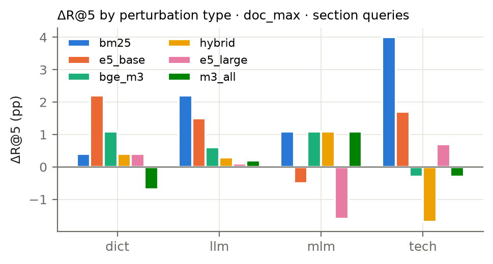

### fig_dose

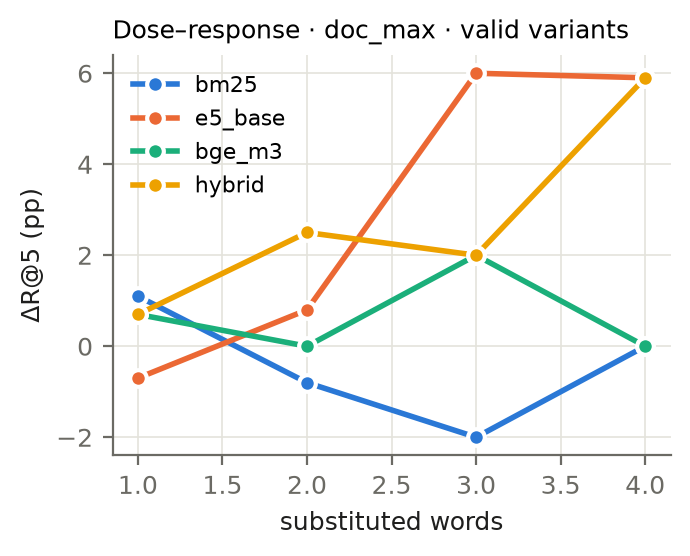

### fig_judge_budget

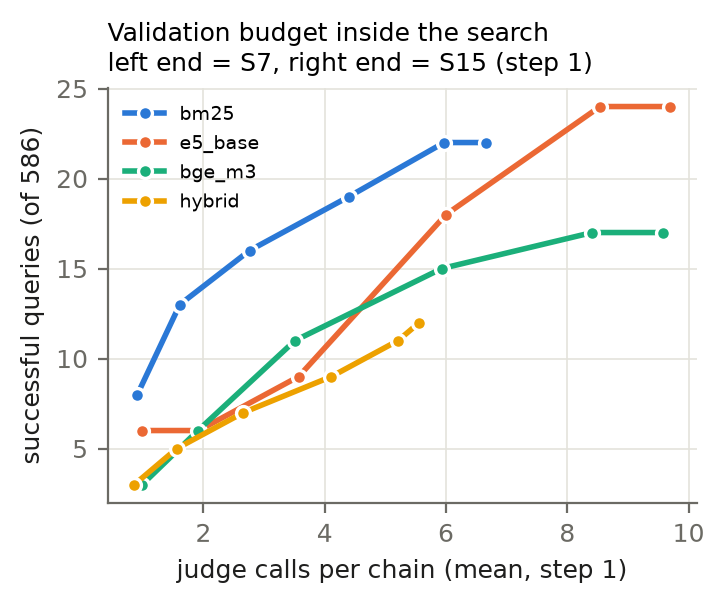

### fig_methods

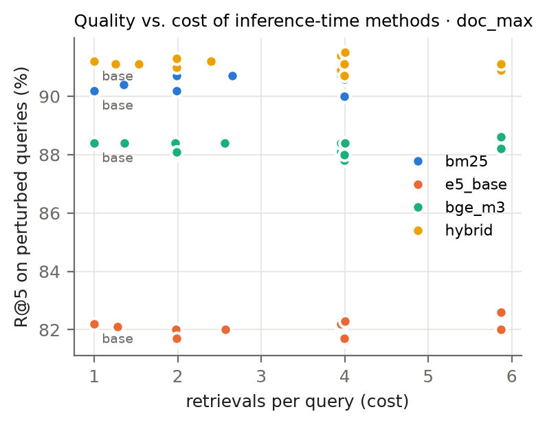

### fig_robustness_chunk_section

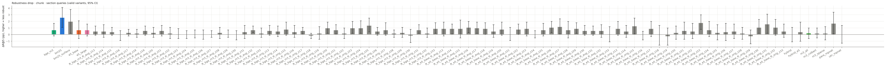

### fig_robustness_doc_full_section

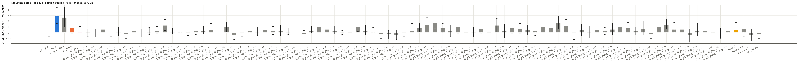

### fig_robustness_doc_full_title

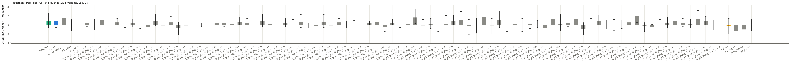

### fig_robustness_doc_max_section

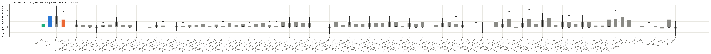

### fig_robustness_doc_max_title

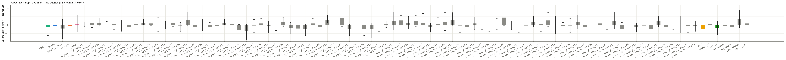

### fig_transfer

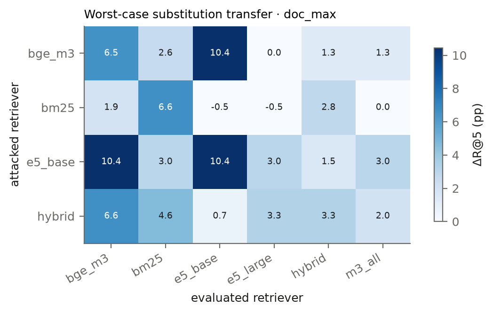

### fig_transfer_s15

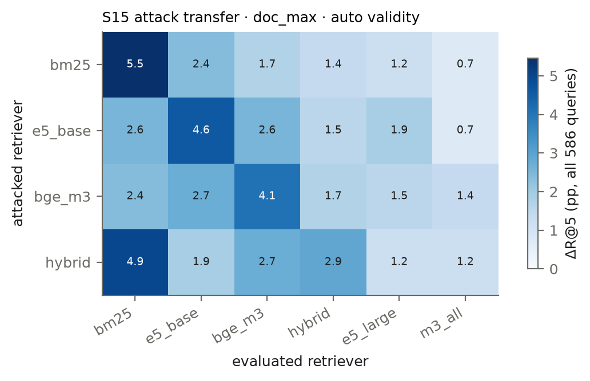

### fig_worst_searches

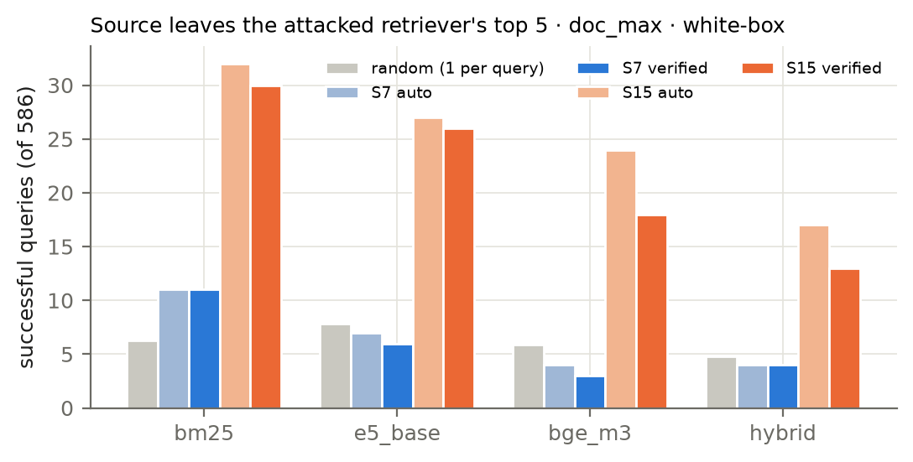

## 11. Files

| What | Path (relative to `experiments/out/`) |
|---|---|
| Full report, all tables and fine-tuning seeds | `tier2/report_variants.md` |
| Worst-case report | `tier2/report_variants_worst.md` |
| Dose-response report | `tier2/report_variants_dose.md` |
| Stability across samples and seeds | `tier2/report_stability.md` |
| Pilot (go/no-go) | `report_tier1.md` |
| Fixed-denominator worst-case report | `tier2/report_worst_verified.md`, `tier2/summary_worst_verified.json` |
| S7 vs S15 protocol and budget audit | `tier2/report_protocol_audit.md`, `tier2/summary_protocol_audit.json` |
| Relevance spot-check of silver labels | `../audit/relevance_report.md`, `../audit/relevance_key.jsonl` |
| Human audit: report, summary, labels | `../audit/audit_report.md`, `../audit/AUDIT_SUMMARY.md`, `../audit/human_labels.jsonl` |
| Manual audit samples (superseded by `experiments/audit/`) | `tier2/audit_sample_variants.md`, `tier2/audit_sample_variants_worst.md`, `tier2/audit_sample_variants_dose.md` |
| Blind human audit: sample, key, tool | `../audit/` |
| Per-query ranks (CSV) | `tier2/per_query_variants*.csv` |
| Failure cases (JSONL) | `tier2/failures_variants*.jsonl` |
| Queries and judged variants | `tier2/queries.jsonl`, `tier2/variants*_judged.jsonl` |
| Figures (PNG + PDF) | `tier2/figures/` |
| Run status and logs | `STATUS.md`, `logs/` |
